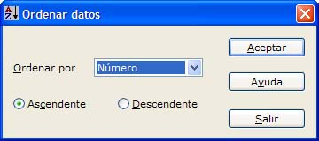

# Arrange data
<!-- id: ordenar-datos -->
<!-- origen: 2232ae91790697ca21331be86bc98085698d8ed6 -->

In this dialog box you can sort the point file or the observation file by any of its fields, in ascending or descending order.

