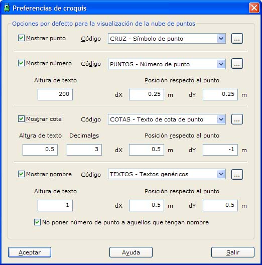

# Sketch preferences
<!-- id: preferencias-de-croquis -->
<!-- origen: 6ad94fa929b68a7a82b684658b51634c91235cd0 -->

From this dialog box you can set up the basic options for viewing the point cloud of a sketch. The data that can be displayed for each point are the following:

* **Point**: The point is a point feature located at the XYZ coordinates that the point has in the file.
* **Number**: The point number is the figure that identifies the point. You can set its size in plot millimeters and the offset of the text relative to the point.
* **Height**: The height can be displayed as a text next to the point. You can set its size in plot millimeters and the number of decimals to display. You can also set the offset of the text relative to the point, in meters.
* **Name**: The point name is the text stored in the field of the same name in the point file. You can set its size in plot millimeters and the offset of the text relative to the point. If the point has a name and the name is displayed, you can enable the option not to display the point number, so that the sketch shows the point name without its number.

For every displayed element you can choose a drawing code from the list. If the chosen code is not in the list, you can open the [drawing code manager](preferencias-de-dibujo/listado-de-codigos-de-dibujo.md) to add a new one or to modify an existing one.

To set the offset of the texts relative to the point, keep in mind that the coordinates of the texts refer to their lower-left corner.

Click the **OK** button to apply the changes and close the dialog box. Click the **Exit** button to close the dialog box without saving the changes.
