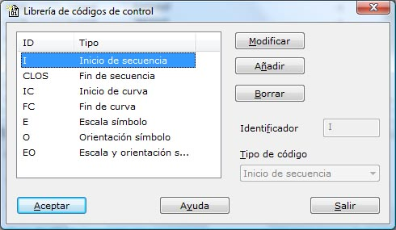

# Control code library
<!-- id: libreria-de-codigos-de-control -->
<!-- origen: 43d34956903264e9126d5be149625d2c03045b72 -->

Control codes are the codes the program uses to find the beginnings or ends of the recording of entities. These codes are added to the entity codes, before or after them, separated by a space.

The program shows a dialog box that lists the existing control codes used to make a sketch automatically.

The available control codes are the following:

* **Begin**: By default, it is *I*. When the program finds this code, it interprets that the recording of that entity begins. If another entity with the same code was being recorded, the program finishes it, even if it has not found a sequence end code.
* **End**: By default, it is *CLOS*. When the program finds this code, it interprets that the recording of that entity ends.
* **Curve begin**: By default, it is *IC*. When the program finds this code, it interprets that a curved element begins, so it computes the curve that passes through the point and the following points until it finds a curve end code.
* **Curve end**: By default, it is *FC*. When the program finds this code, it interprets that the recording of a curved element ends.
* **Symbol scale**: By default, it is *E*. When the program finds this code, it interprets that the point determines the size of the symbol previously placed at another point. The scale is the distance between both points.
* **Symbol orientation**: By default, it is *O*. When the program finds this code, it interprets that the point determines the orientation of the symbol previously placed at another point.
* **Symbol scale and orientation**: By default, it is *EO*. When the program finds this code, it interprets that the point determines the size and the orientation of the symbol previously placed at another point.
* **Symbol EN scale and orientation**: By default, it is *EXYO*. When the program finds this code, it interprets that the point determines the scale in Y. It should be preceded by a *scale and orientation* code in which the X scale and the orientation of the symbol were indicated.
* **Area end**: By default, it is *SUP*. When the program finds this code, it interprets that the point is the last point of a line that is also closed, so it automatically includes as the last segment a vector to the first point of the entity.
* **Continue**: By default, it is *CONT*. When the program finds this code, it interprets that the user wants to continue the last entity that was recorded with the same code, even if that entity has been finished.

After you finish the definition, click the **OK** button to view the data or the **Exit** button to leave the dialog box.
