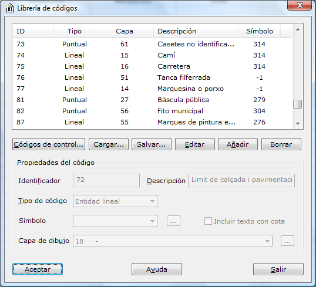

# Code library
<!-- id: libreria-de-codigos -->
<!-- origen: 388d37ced47632a45e04c984e58170fd72391534 -->

This dialog box lists the existing codes and the drawing layers in which they are recorded when the sketch is made.

Codes are annotations made in the field together with the observations, to make the office work of producing the mapping easier.

That is, while points are being recorded, you can add additional information indicating which type of geographic entity the point belongs to (sidewalk, building, manhole, etc.) so that, later, when the program computes the coordinates of the points, it can automatically rebuild the entities recorded in the field.

This avoids the need to keep a sketch in the field where the points that are being taken are noted down.

For the program to rebuild the entities correctly, you must include certain annotations that indicate where the entities begin or end, where an arc of a circle begins or ends, etc. These annotations are called control codes. To edit these codes, click the [Control codes](lista-de-codigos-de-control.md) button located at the lower left of the code list.

In the dialog box, three buttons appear at the lower right of the code list (**Edit**, **Add** and **Delete**) that let you modify, add and remove sketching codes, respectively.

When you click the **Add** or **Edit** button, the fields at the bottom are enabled so that you can modify them. These fields are the following:

* **Identifier**: This identifier corresponds to the annotation associated with the recorded point, which must be related to the geographic entity being recorded. They are usually short strings of characters, so that they take less time to type; for example, *A* corresponds to *Sidewalks*, *E* to *Buildings*, *B* to *Curb*, etc. If two buildings were being recorded at the same time, you could use the identifiers *E1* and *E2*, so that the program does not relate points incorrectly. If the point is the beginning or end of an entity, or the beginning or end of a curve, the identifier must be accompanied by the corresponding control code, separated by a space. For example, beginning of a sidewalk "*A I*", beginning of a curb arc "*B IC*", etc.
* **Description**: This field is reserved for the user to enter information that describes the identifier in more detail. It is optional.
* **Type code**: You can choose between line entity and point entity. If the entity is a point entity, the next field is enabled so that you can specify a symbol, if any.
* **Symbol**: If the entity is a point entity, you can specify a symbol associated with the code, which is placed at the position of the point. The list of available symbols is shown in the [Symbol library](../preferencias-de-simbolizacion/libreria-de-simbolos.md) tool of the [Edit menu](../../menus-de-la-aplicacion/menu-editar.md).
* **Include elevation text**: If the entity is a point entity, you can specify that the point always shows a text with the elevation value. This field is intended for the codes recorded in the field that are considered spot elevation points in the final mapping. The characteristics of the placed text are the same as those set in the [Sketch preferences](../preferencias-de-croquis.md) dialog box.
* **Sketch layer**: This field is reserved for specifying the drawing layer in which the entity is recorded. That is, several sketching codes can generate entities for the same layer. Continuing with the previous example, *E*, *E1* and *E2* generate drawing entities that are recorded in the *BUILDINGS* layer. These layers are defined in the [Drawing code list](../preferencias-de-dibujo/listado-de-codigos-de-dibujo.md) tool of the [Edit menu](../../menus-de-la-aplicacion/menu-editar.md). If the layer has not been created and is therefore not in the list shown, you can open this tool by clicking the button on the right.

When you add a sketching code, you will see that, at the same time that the fields are enabled, all the buttons are disabled except the **Add** and **Cancel** buttons, so that the user can accept or discard the data entered. The same happens when data are being modified, where only the **Edit** and **Cancel** buttons remain enabled.

Two additional buttons located at the lower center of the code list let you **Load** or **Save** the lists to disk.

After you finish the definition, click the **OK** button to view the data or the **Exit** button to leave the dialog box.
