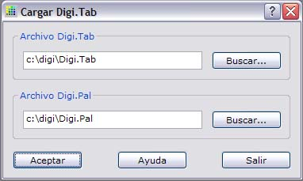

# Load DIGI.TAB
<!-- id: cargar-digi-tab -->
<!-- origen: b1057f1697c5c6994ae1630ed0bdc953e371c20a -->

In this dialog box you can load the DIGI view codes. Enter the location of the **DIGI.TAB** file and of the **DIGI.PAL** file, where the colors are defined, to load the codes and their colors.

If the DIGI.PAL file is not found, the program assigns the MS-DOS colors.
