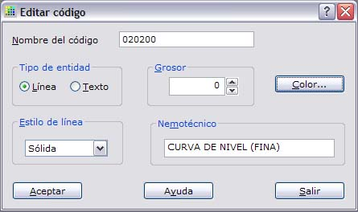

# New drawing code
<!-- id: codigo-de-dibujo-nuevo -->
<!-- origen: 769799d1e79a2be8b7f00a40e0851f0828f11a5b -->

This dialog box contains the following fields to fill in:

* **Code name**: Enter the name of the new code or, if the code is not new, edit the existing one.
* **Type of entity**: It can be line (**C**) or text (**T**).
* **Weight**: Specify a line weight between 0 and 10.
* **Line style**: It can be Solid (continuous line), Lines (dashed line), Points (dotted line), Line-Point, Line-Point-Point.
* **Color**: You can specify a color.
* **Mnemonics**: You can assign an explanatory text to the new code.
