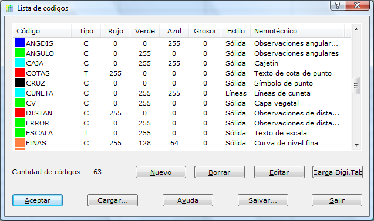

# Drawing code list
<!-- id: lista-de-codigos-de-dibujo -->
<!-- origen: 25669710352f26246d25a4184b40ecd0df17efba -->

This dialog box shows the codes that the program uses to paint the entities on the screen. If a code used in the documents is not in this list, the entity is displayed in gray with the default weight.

The listed codes can refer to texts or to lines, and you can specify the weight, color and style of the line.

You can save this list to a text file or load it from one.

You can add new codes and edit or delete existing ones. When you click the **New** or **Edit** button, a [dialog box](codigo-de-dibujo-nuevo.md) appears where you can set the display characteristics of the code.

You can also load the codes stored in the **DIGI.TAB** table that belongs to the DIGI program. To do so, click the [**Load Digi.Tab**](cargar-digi-tab.md) button.

The changes you make are valid only if you click the **OK** button to exit.
