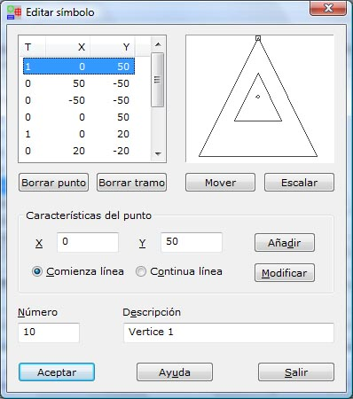

# Edit symbol
<!-- id: editar-simbolo -->
<!-- origen: c801a7dc1fa85971e5c0a7f3f329c51f2b0d0023 -->

This dialog box shows the characteristics of a symbol, including the entities, made up of points, that define it.

A list shows the coordinates of the points that define the symbol, with an additional field on the left that indicates whether the point starts a new polyline, a sequence of connected vertices (1), or continues the current polyline (0). When you select a point in this list, the preview on the right shows a square that indicates the position of that point. The same drawing also shows a dot that marks the anchor point of the symbol, which corresponds to the coordinates 0,0.

You can delete a single point of a string or delete a whole string by using the buttons at the bottom.

In addition, you can **Add** a new point or **Modify** an existing one by using the fields below. In these fields you can set the X and Y **coordinates** of the point in tenths of a millimeter, as well as whether the point starts a new string (**Start of string**) or continues the current one (**Inner of a string**).

The design size of the symbol is the same as it has when printed, so its size on the screen depends on the scale value of the sketch.

You can move or scale the coordinates of the symbol by clicking the **Move** or **Scale** buttons.

Finally, you can change the **Number** that identifies the symbol and its **Description**.

After you finish the definition, click the **OK** button to view the data or the **Exit** button to leave the dialog box.
