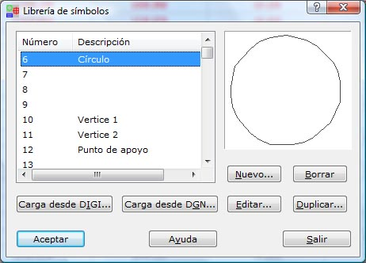

# Symbol library
<!-- id: libreria-de-simbolos -->
<!-- origen: 02a70d92d0bc2af7558624f96e56f3fc45dadeaf -->

This dialog box shows a list of the symbols available to be inserted in the sketch and a preview of their drawings.

The symbol identifiers are stored as numeric strings, and you can add a description. You can load the symbols used by DIGI by using the TEXT.FNT file. You access this option with the **Load from DIGI...** button.

You can also load the cells stored in a file with the CEL extension, which is specific to MicroStation. You access this option with the **Load from DGN...** button.

From this dialog box you can create a **New** symbol, **Delete** a symbol, **Edit** a symbol, or **Duplicate** a symbol with a different symbol number, by clicking the buttons available for that purpose. When you edit or create a symbol, the program shows the [Edit symbol](editar-simbolo.md) dialog box.

After you finish the definition, click the **OK** button to view the data or the **Exit** button to leave the dialog box.
