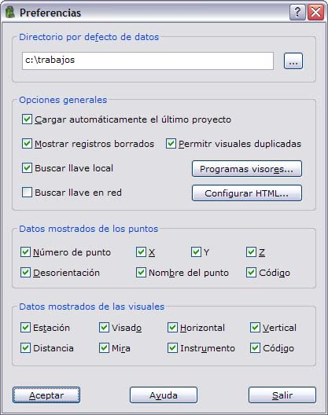

# Preferences
<!-- id: preferencias -->
<!-- origen: 0108e642517117202b136cf01c459ffab14b5bf0 -->

From this dialog box you can set up the basic options for viewing the data (points and observations), the default directory where the generated projects are stored, and other options of the application:

* **Default data directory**: This directory indicates where the folders that contain the generated projects are created. You can use the button on the right to display a tree with the available drives and select a new directory. If you type a directory that does not exist, the application creates it.
* **General options**:
  * **Automatic loading of the last project**: When the program starts, this option automatically displays the project that was last modified the last time the program was used.
  * **Display erased registers**: Displays records marked as deleted in red in the current list.
  * **Duplicated observations**: Allows the observation file to store several observations between the same two points. This option is useful if you want to compute the systematic errors of the surveying instrument, which requires observations taken in direct circle and inverse circle.
  * **Dongle settings**: From here you can set up where the program has to look for the dongle. The dongle can be connected to a USB port of the computer or located on a server. To do so, select **Search local dongle** in the first case and/or **Search network dongle** in the second case. If you do not have a network dongle, clear this second option; otherwise the program searches the computer network for a dongle even when no network dongle is available.
  * **Viewer programs**: With this button you can set up the location of the programs used to view the output reports with the computations in TXT and html formats.
  * **Setting HTML**: From here you can set up the output of the different computations in html format. You can select the text font and the color of the tables generated by the application.
* **Point data displayed**: With this option you can select the fields of the point files that you want to view in the spreadsheet.
* **Observation data displayed**: With this option you can select the fields of the observation files that you want to view in the spreadsheet.
* **Default number of decimal places of the data**: There are two fields to set the number of decimals to display for the data in the different computations and lists generated by the program. The data are divided into *angular* and *linear* (coordinates and distances). These values are used for the new projects that you create. However, you can later change them individually for each project from the [Project properties](propiedades-de-los-objetos/propiedades-del-proyecto.md) dialog box.

Click the **OK** button to apply the changes and close the dialog box. Click the **Exit** button to close the dialog box without saving the changes.

> [!NOTE]
> The **Dongle settings** option applies only to dongle protection. If the computer has a software license activation, Topcal21 uses the license and does not look for the dongle. See [Software licenses](../../licencias-de-software/README.md).
