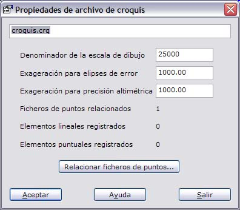

# Sketch file properties
<!-- id: propiedades-de-archivo-de-croquis -->
<!-- origen: 0f2c8a5faa3e0ba435b35980d2ab422b81494a80 -->

This dialog box shows the properties of the current sketch file, among them:

* **Filename**
* **Denominator of the scale sketch**: This value determines the size of the texts and symbols displayed on the screen, such as the point numbers or their elevations.
* **Exaggeration to error ellipses**: Exaggeration factor used to display the error ellipses stored in the sketch. These error ellipses can be generated after performing a [least squares compensation](../../herramientas/compensacion-por-minimos-cuadrados/README.md) of a surveying network.
* **Exaggeration for precision altimetry**: Exaggeration factor used to display the lines that represent the altimetric accuracy stored in the sketch. These lines can be generated after performing a [least squares compensation](../../herramientas/compensacion-por-minimos-cuadrados/README.md) of a surveying network.
* **Linking Point files**: Number of point files that are being displayed. You can change this relation by clicking the **Link Point files** button.
* **Registered linear elements**
* **Registered point elements**

Click the **OK** button to save the changes of the sketch. Click the **Exit** button to close the dialog box.
