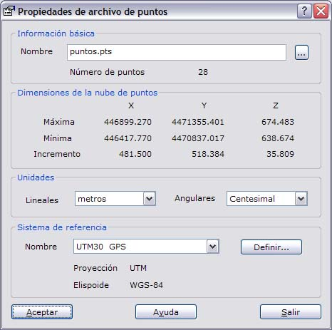

# Point file properties
<!-- id: propiedades-de-archivo-de-puntos -->
<!-- origen: d6eff40f25a35acac423d8bfe4d44964bdae9185 -->

This dialog box shows the properties of the current point file, among them:

* **Filename**
* **Number of points** it contains
* **Maxima and minima** of the coordinates it contains.
* **Linear units**: Units in which the coordinates of the points are stored. You can choose between *feet* and *meters*.
* **Angular units**: Units in which the orientations of the points are stored. You can choose between *grads*, *degrees* and *pseudodecimal degrees*.
* [Reference system](../../otros-comandos/sistemas-de-referencia/listado-de-sistemas-de-referencia.md): Shows the reference system to which the coordinates refer. This reference system directly affects the way the program computes. You can change the coordinate system by clicking the **Define** button.

Click the **OK** button to save the changes of the point file. Click the **Exit** button to close the dialog box.
