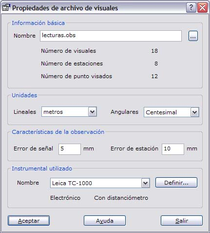

# Observation file properties
<!-- id: propiedades-de-archivo-de-visuales -->
<!-- origen: f42d270d8c27eef2659e7054364a6c035cd5ecbe -->

This dialog box shows the properties of the current observation file, among them:

* **Filename**
* **Number of observations** it contains.
* **Number of stationed points**.
* **Number of target points**.
* **Linear units**: Units in which the distances, reflector heights and instrument heights of the observations are stored. You can choose between *feet* and *meters*.
* **Angular units**: Units in which the measured angles are stored. You can choose between *grads*, *degrees* and *pseudodecimal degrees*.
* **Observation features**: Error made when setting up the instrument over a point and when signaling the points. For a station set up with a tripod and signaling with a prism pole, 5 mm is a common value. If the signaling was done with greater precision, you can reduce it. It affects only the computation of the accuracy of the observations.
* [Used instrument](../../otros-comandos/instrumentos-topograficos/listado-de-instrumentos-topograficos.md): Shows the instrument used to take the stored observations. You can change this instrument with the **Define** button.

Click the **OK** button to save the changes of the observation file. Click the **Exit** button to close the dialog box.
