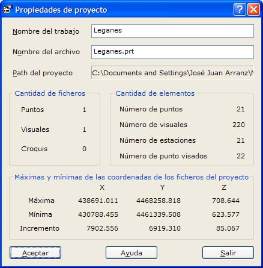

# Project properties
<!-- id: propiedades-de-proyecto -->
<!-- origen: b125418d5fcdf1f9f426531451c6e6b7391dc4ec -->

This dialog box shows the properties of the current project, among them:

* **Project name**
* **Job name**
* **Folder** where it is stored
* **Number of files** of points, observations and sketches it contains
* **Number of elements**, such as the number of points, observations, stations and target points.
* **Maxima and minima** of all the coordinates contained in the point files of the project.
* **Number of decimal data**: There are two fields to set the number of decimals to display for the data in the different computations and lists generated with this project. The data are divided into *angular* and *linear* (coordinates and distances).

Click the **OK** button to save the changes of the project. Click the **Exit** button to close the dialog box.
