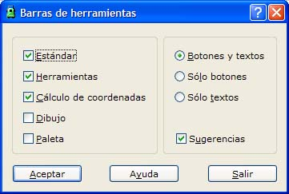

# View toolbars
<!-- id: ver-barras-de-herramientas -->
<!-- origen: 26fc06c76489af1373de4b7b54224eacf1343f66 -->

In this dialog box you can choose the viewing options available in the program, which are:

* **Selection of the desired toolbars**: Select the toolbars you use most often so that their icons and calls are more accessible.
* **Selection of the toolbar information**: You can choose whether the program shows only the icon, the icon with an explanatory text, or only the text.
* **Selection of additional options**: You can choose whether the program shows additional information when the mouse is placed over a tool, and whether it plays a sound when it finishes the computation operations.
