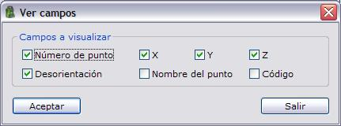
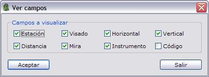

# View fields
<!-- id: ver-campos -->
<!-- origen: bbbb509fd63892cd4bbcb0c592337b7ba7d7b053 -->

From this dialog box you can choose the fields to display, both in the point files and in the observation files. To display this dialog box, right-click the header of the data shown in TopCal. A context menu appears that contains the **View fields** option. When you choose it, a dialog box appears whose content varies according to the type of the current file:

* If it is a point file, the data you can choose are: *Point number*, *E*, *N*, *H*, *Orientation*, *Point name* and *Code*.
* If it is an observation file, the data you can choose are: *Station*, *Target*, *Horizontal*, *Vertical*, *Distance*, *Reflector*, *Instrument* and *Code*.

You can also select these fields from the [Preferences](preferencias.md) dialog box of the [Edit menu](../menus-de-la-aplicacion/menu-editar.md).
