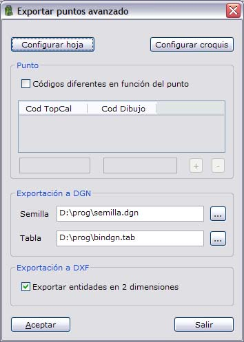

# Export points to a drawing file
<!-- id: exportar-puntos-a-archivo-de-dibujo -->
<!-- origen: 059a26420974e942cbd359ee6e11b69c48d3312c -->

When you run the Export tool from the [File menu](../menus-de-la-aplicacion/menu-archivo.md) while a point file is active, a dialog box appears in which you can specify the file name and type. If the selected type is a drawing file format (DIGI BIN or ASCII, AutoCAD DXF or MicroStation DGN), the program lets you configure how the point cloud will be translated. You access this configuration by clicking the **Advanced...** button that appears.

When you click **Advanced...**, the program displays a dialog box with the following fields:

* **[Setting sheet](../dibujo/insertar-hoja.md)**: Click this button to configure the sheet frame with coordinates to be inserted with the point cloud.
* **[Setting sketch](../opciones-de-visualizacion/preferencias-de-croquis.md)**: Click this button to configure the information that will appear for each point in the drawing file, that is, whether you want the elevation, the point number or the point name. You can also specify the codes, text heights, etc.
* **Different codes depending on the point**: By default, all points are translated to the same code or layer. However, you can tell the program to store the points in different layers of the drawing file depending on the TopCal code of each point. To do so, enable this field and fill in the relation table that appears below it.
* **DGN Export**: When points are translated to the MicroStation DGN format, you must specify a seed file. TopCal 21 reads the translation characteristics from the seed file, such as the units and the dimension (2D or 3D). In addition, you can specify a file that maps the display codes used in the program to the MicroStation coding format (level, style, color, weight and graphic group):
  * **Seed**: Enter the name of a seed DGN file. It is required. It should be an empty file, because the program copies it with the name of the generated DGN file and keeps its characteristics (units, dimension, etc.). The program installation provides a seed file in three dimensions with centimeters as the minimum unit.
  * **Table**: Enter the name of an ASCII file that specifies how to translate the entities. It is optional. The program installation also provides an example translation table. Each line of the file must have the fields separated by commas, spaces or tabs, in the following order:
    * DIGI code: Code in which the entities are recorded in TopCal.
    * Level: Level of the DGN file in which the entities with the specified DIGI code will be stored.
    * Style: Of the line in the DGN file.
    * Color: Of the line in the DGN file.
    * Weight: Thickness of the line in the DGN file.
    * Text font: Font number in the DGN file.
    * Graphic group: Of the entity in the DGN file.
    * Cell name: Name of the symbol in the DGN file.
    * Element type: It can take the values 0 (line string), 1 (shape), 2 (pattern line), 3 (cell) or 4 (text).
    * Text height in meters: In the DGN file.
    * Text width in meters: In the DGN file.
    * Text justification: In the DGN file.
    * Fill color: Of the closed entity in the DGN file.
* **DXF Export**: When points are translated to the AutoCAD DXF format, you can specify that the translation be in 2 dimensions, that is, using entities that have no elevation. To do so, enable the field indicated.

You can click the **OK** button to proceed with the computation or click the **Exit** button to return to the previous dialog box.
