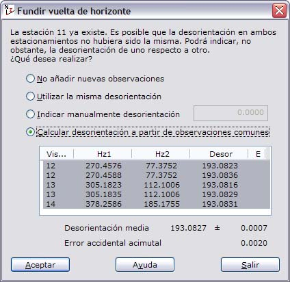

# Joining observations
<!-- id: fundir-vuelta-de-horizonte -->
<!-- origen: ddeccd783672dfede127288c8300019fdbb4c3fd -->

When you import observation files into an observation file that already contains data, or add them to it, you may be adding a station that is already in the file. In this case, the program detects the problem and warns you, because the two station setups could have a different orientation.

This happens when two station setups were made at the same point on different days and you want to join all the observations. Two station setups at the same point may use different origins for the horizontal angles. For this reason, it is not advisable to join all the observations without processing them first so that all the horizontal angles refer to the same origin.

Therefore, when this problem occurs, TopCal 21 displays the following dialog box, with several options:

The dialog box shows a message with the number of the imported station that already exists in the current file, and asks which of the following operations to perform:

* **Not add new observations**: The program does not take into account the observations made from this station.
* **Use the same orientation**: The program adds the observations directly to the current file without applying any offset to the horizontal readings. This is the case when the orientation of the instrument was set to the same direction in both station setups.
* **Designate an orientation**: The program adds the value entered in the field to the right of this option to the horizontal readings of the imported observations and adds those observations to the current file.
* **Compute orientation from common observations**: The program looks for observations common to both station setups and shows them in the list. For each of them, it calculates the offset between the observations made on the first day and those made on the second day, and shows it in the list. From the observations made, the program calculates the **average** and the **standard deviation** and shows them at the bottom of the list. It also shows the **accidental error** of the instrument to help you decide whether the computation is suitable. To exclude a common observation from the calculation of the average of the offsets, clear the selection of that observation. However, if any of the calculated values differs from the average value by more than 2.5 times the standard deviation, the program places a "\*" mark to its right, indicating that this observation is erroneous with 99% probability. The average value is added to the observations read before they are added to the file.

You can choose one of these options and click the **OK** button to apply it, or click the **Exit** button to abandon the Joining observations operation.
