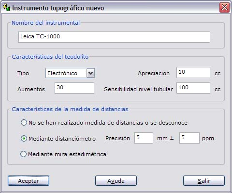

# New surveying instrument
<!-- id: instrumento-topografico-nuevo -->
<!-- origen: fd6c66dc9fc75ead7ff4001d2236cbd6176d6d4c -->

The program calculates the accuracy of the observations used in a computation from the surveying instrument. Enter the features of the instrument that appear in the dialog box, so that the program uses that accuracy when weighting the observations:

* **Instrument name**: Enter a unique name for the surveying instrument that helps you select it in later lists.
* **Theodolite features**
  * *Type*: Select the type of theodolite, choosing between *Optical* and *Electronic*. This choice affects only the formula used to calculate the reading error of the instrument.
  * *Angle accuracy*: Enter the smallest amount that the instrument can read in its angle measurement system.
  * *Magnification*: Enter the magnification of the lenses.
  * *Level sensitivity*: Enter the sensitivity of the instrument's tubular level.
* **Distance measurement features:** Select the type of distance measurement that was made, if it is known. If it is unknown, select the first option. If the instrument has an *EDM* (electronic distance measurement) for electromagnetic distance measurement, select the second option. In this case, the boxes for its *accuracy* are enabled, expressed as a fixed part (in millimeters) and a variable part (in parts per million). If a *stadia rod* has been used, select the third option.
