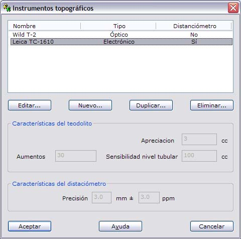

# Surveying instruments
<!-- id: topcal21-otros-comandos-instrumentos-topograficos-listado-de-instrumentos-topograficos -->
<!-- origen: 830b99ce3e6e33d7ea90e252f84455cd8a99b131 -->

The application lets you define the surveying instruments used to take the measurements stored in the observation files. In this way, when you create an observation file you can specify which instrument was used. This lets the program know the accuracy with which the measurements were made, and when a computation needs to weight the observations, it uses the accuracy of the instrument that was used. For example, when least squares is used to calculate coordinates, it is normal to weight the observations inversely proportionally to their accuracy. That accuracy depends on the characteristics of the observation itself and on the accuracy of the instrument used.

These definitions are stored in a file located in the same folder as the executable file, named **Instrumentos.dat**.

The program shows the stored instruments in a dialog box, which contains the following fields:

* **List of instruments**: Shows the different stored instruments, so that you can [Edit](instrumento-topografico-nuevo.md) an existing instrument, create a [New](instrumento-topografico-nuevo.md) one, or **Duplicate** or **Delete** it. The list shows the name of the instrument, whether it is *Optical* or *Electronic* and the type of distance measurement.
* **Theodolite features**: This section shows the features of the theodolite of the instrument selected in the list. These features are the *Angle accuracy*, the *Magnification* and the *Level sensitivity*.
* **EDM instrument features**: This section shows the features of the EDM (electronic distance measurement) of the instrument selected in the list, if it has one. These features are summarized in the *accuracy* of the EDM itself.
