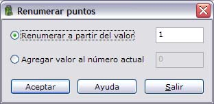

# Renumber points
<!-- id: renumerar-puntos -->
<!-- origen: 634a4d76092d8c70d82b26180caca95837851d46 -->

This tool renumbers the points of the current file, keeping the order they currently have. The program offers two options for this operation:

* **Renumber from the value**: The program renumbers all the points starting from the specified value.
* **Add value to current number**: The program adds the specified value to the number that the points currently have.
