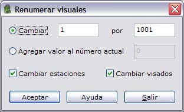

# Renumber observations
<!-- id: renumerar-visuales -->
<!-- origen: feab72abd3170f9408242f1bfa65b32c500affce -->

This tool modifies the station and target point numbers of the observations in the current file, keeping the order they currently have. The program offers two options for this operation:

* **Change**: Replaces the specified number with the new number in the observations whose station number or target point number matches the specified number, according to the **Change stations** and **Change target points** check boxes.
* **Add value to current number**: Adds the specified value to the station number or the target point number of the observations, according to the **Change stations** and **Change target points** check boxes.

In addition, the program lets you specify whether you want to **Change stations** and/or **Change target points**.
