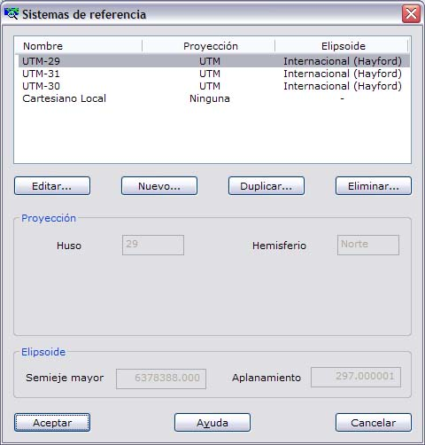

# Reference systems
<!-- id: topcal21-otros-comandos-sistemas-de-referencia-listado-de-sistemas-de-referencia -->
<!-- origen: a9149acd9eca44791c2911351c6d0dd773482802 -->

The application lets you create point files referred to different coordinate systems. To do so, you must first define the reference systems that are available for creating new point files. This definition allows the program to use certain formulas in the computation processes. The program stores the reference systems in the **Sistema de Referencia.dat** file, located in the same folder as the executable.

From this dialog box, the user can define the reference systems considered suitable for working with coordinate files. Keep in mind that reference systems consist of the choice of a map projection and a reference ellipsoid. If the user is not using coordinates in a map system, because the object being measured is very small, a local coordinate system can be selected, in which no projection needs to be chosen.

The dialog box shows a list of the currently stored reference systems and a series of options for working with them. The fields shown are the following:

* **List of existing reference systems**: Shows a list of the systems with their name, projection type and the name of the ellipsoid used. From here you can [Edit](sistema-de-referencia-nuevo.md) an existing system, create a [New](sistema-de-referencia-nuevo.md) one, or **Duplicate** or **Delete** it.
* **Projection**: This section shows the parameters of the projection of the system selected in the list. These parameters depend on the type of projection selected.
* **Ellipsoid**: This section shows the semi-major axis of the ellipsoid and its flattening, for the system selected in the list.
