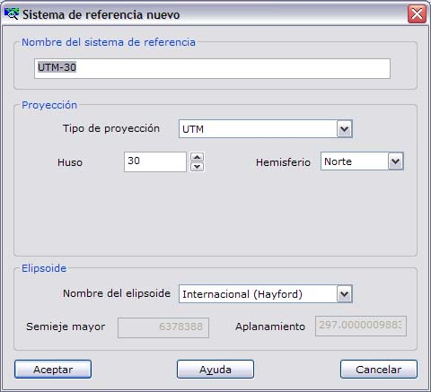

# New reference system
<!-- id: sistema-de-referencia-nuevo -->
<!-- origen: afb7743650678eff2f13265e8c1eef92cd0b72cf -->

The reference system tells the program which type of coordinates is used in each file. Select the reference system used by the coordinates in the point files. The program cannot mix coordinates from different reference systems in its computations.

When you create or edit a reference system, the application displays a dialog box showing the following parameters, which let the user edit the reference system suitable for the coordinates of the point files:

* **Reference system name**: Enter a unique name for the system you create that helps you select it in later lists. Therefore, it should refer to the projection that its definition contains.
* **Projection**
  * *Type of projection*: Select the type of projection. If the selected projection type is **None**, the remaining fields are disabled, because the coordinates are understood not to correspond to any map projection. This is the case of local coordinates. You can also indicate whether you want the program not to *reduce distances to the chord of the ellipsoid*. The available projections are UTM, Lambert conformal conic with two parallels, or Lambert conformal conic with one parallel.
  * *Projection parameters*: Depending on the type of projection selected, some parameters or others are enabled to define the projection.
    * For the UTM projection:
      * Zone
      * Hemisphere
    * For the Lambert conformal conic projection with two parallels:
      * Longitude origin
      * Latitude origin
      * False East
      * False North
      * Parallel 1
      * Parallel 2
    * For the Lambert conformal conic projection with one parallel:
      * Longitude origin
      * Latitude origin
      * False East
      * False North
      * Scale
* **Ellipsoid**
  * *Ellipsoid name*: Enter the name of the ellipsoid. A list of ellipsoids stored by default in the application appears, or the user can define one. If an ellipsoid from the list is chosen, the values of the ellipsoid definition cannot be edited.
  * *Semi-major axis*: Value of the semi-major axis of the ellipsoid, in meters.
  * *Flattening*: Inverse flattening, 1/f, where f is the ellipsoid's flattening. This value is dimensionless.
