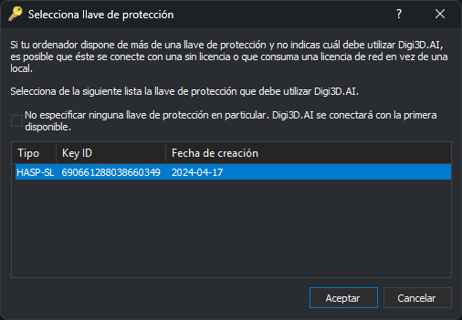

# Selecciona llave
<!-- id: selecciona-llave -->

Este programa permite especificar con qué llave de protección debe conectarse un programa en particular.

Todas nuestras aplicaciones (_Digi3D.AI, Topcal21, MDTopX_,...) instalan un programa denominado **Seleccionar Llave** que permite especificar con qué llave de protección debe conectarse el programa.

Si dispones de varias llaves de protección y no configuras una llave de protección en particular para un determinado programa, éste se conectará con la primera disponible, y es posible que la llave de protección con la que se conecte no disponga de licencia para ese programa.

Supongamos que dispones de dos llaves de protección, _A_ y _B_. En la llave _A_ tienes adquirida una licencia de _Digi3D.AI_, y en la llave de protección _B_ tienes un alquiler de _MDTopX_.\
Si no has configurado _MDTopX_ para que se conecte con la llave de protección _B_, es posible que éste al ejecutarse localice primero la llave de protección _A_, mostrándote el mensaje [Soporte técnico finalizado](/acerca-llaves-proteccion/solucion-de-problemas/soporte-tecnico-finalizado.md).

Para solucionar este problema deberás indicarle a _MDTopX_ que debe utilizar la llave de protección _B_. Esto lo puedes hacer con el programa **Seleccionar Llave** que encontrarás en _Inicio/Todos los programas/Digi21.net/MDTopX_.\
El programa **Seleccionar Llave** para configurar Digi3D.AI lo puedes encontrar en _Inicio/Todos los programas/Digi21.net/Digi3D.AI_.\
El programa **Seleccionar Llave** para configurar Topcal21 lo puedes encontrar en _Inicio/Todos los programas/Digi21.net/Topcal21_.

El programa muestra la lista de llaves de protección conectadas al ordenador, con la llave configurada seleccionada. Selecciona la llave que debe utilizar el programa y pulsa el botón **Aceptar**.

El cuadro de diálogo dispone de una casilla de verificación para indicar que no quieres configurar ninguna llave en particular. Si la marcas y pulsas el botón **Aceptar**, se eliminará la configuración de una llave en particular y el programa se conectará con la primera llave de protección disponible.

El programa necesita permisos de administrador para guardar la configuración: Windows te pedirá confirmación al ejecutarlo.

En la siguiente captura de pantalla puedes ver el programa **Seleccionar Llave** de _Digi3D.AI_.

