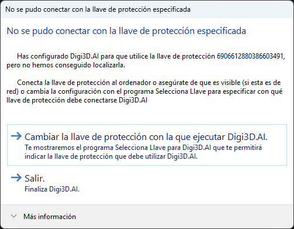

# No se pudo conectar con la llave de protección especificada
<!-- id: no-se-pudo-conectar-llave-proteccion -->

No hemos conseguido conectarnos con la llave de protección que tienes configurada para el uso del programa que ha mostrado este mensaje de error.

Este mensaje se muestra cuando has indicado mediante el programa **Selecciona Llave** específico del programa que estás intentando ejecutar que éste debe utilizar una determinada llave de protección, pero no hemos localizado dicha llave de protección

A continuación, te enumeramos las posibles causas de este error y las soluciones:

| Causa | Solución |
| :--- | :--- |
| La llave de protección especificada no está conectada o no es accesible. | Conecta la llave de protección en el ordenador en el que estás ejecutando el programa que te ha mostrado el mensaje de error.; Si la llave de protección es física, debe encenderse un led indicando que Windows la ha reconocido satisfactoriamente.; Si la llave de protección es de red, asegúrate de que el servidor en el que está conectada o instalada es visible desde el ordenador en el que estás intentando ejecutar el programa que te ha mostrado el mensaje de error. |
| La llave de protección especificada es una llave de protección provisional y esta ha caducado. | Las llaves de protección provisionales tienen una duración máxima de 90 días desde el momento en que se utilizaron por primera vez. Si ya se ha superado la fecha de expiración de llaves de protección provisionales, tendrás que convertirla en una llave de protección permanente. |
| La llave de protección especificada es una llave de protección de red y se han agotado todas las conexiones. | Espera a que otro usuario termine de trabajar con el programa que estás intentando ejecutar o compra una activación más para tu llave de protección de red. |
| Has configurado incorrectamente la llave de protección que debe utilizar el programa que te ha mostrado este mensaje de error. | Ejecuta el programa **Selecciona Llave** del programa que estás intentando ejecutar y selecciona la llave de protección correcta. |

## Contenido del cuadro

* **Texto**: el identificador de la llave de protección configurada.
* **Más información**: recuerda que, si esa es la llave que quieres utilizar, tienes que activar el ordenador en ella con el programa **Activar Ordenador**.

## Botones

Digi3D.AI muestra este cuadro al arrancar. El editor de tablas de códigos (DigiTab) muestra el mismo cuadro al arrancar, con los mismos textos, porque usa la llave de protección configurada para Digi3D.AI.

* **Cambiar la llave de protección con la que ejecutar Digi3D.AI.**: abre el programa **Selecciona Llave** y cierra el programa que ha mostrado el cuadro. Después de seleccionar la llave, vuelve a ejecutar el programa.
* **Salir.**: cierra el programa que ha mostrado el cuadro.

