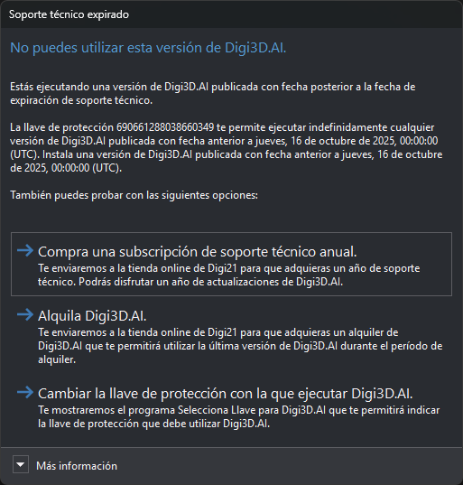

# Soporte técnico finalizado
<!-- id: soporte-tecnico-finalizado -->

Estás intentando ejecutar una versión de cualquiera de nuestros programas publicada con fecha posterior a la fecha máxima de soporte técnico que habías contratado.

Puedes resolverlo de cualquiera de estas formas:

1. Adquiere un año de soporte técnico y actualizaciones en nuestra [Tienda Online](http://www.digi21.net/Tienda/Compra).
2. Alquila el programa en nuestra [tienda de alquileres](http://www.digi21.net/Tienda/Alquiler). Durante el período de alquiler podrás utilizar la última versión.
3. Desinstala la versión del programa que estás intentando ejecutar e instala una versión publicada con fecha anterior a la fecha de expiración del soporte técnico que tienes contratado.
4. Si tienes otra llave de protección con el soporte técnico en vigor, indica al programa que la utilice con [Selecciona Llave](/acerca-llaves-proteccion/programas-relacionados-con-licencias-y-llaves-de-proteccion/selecciona-llave.md).

A continuación, te mostramos cómo comunica Digi3D.AI esta eventualidad:

