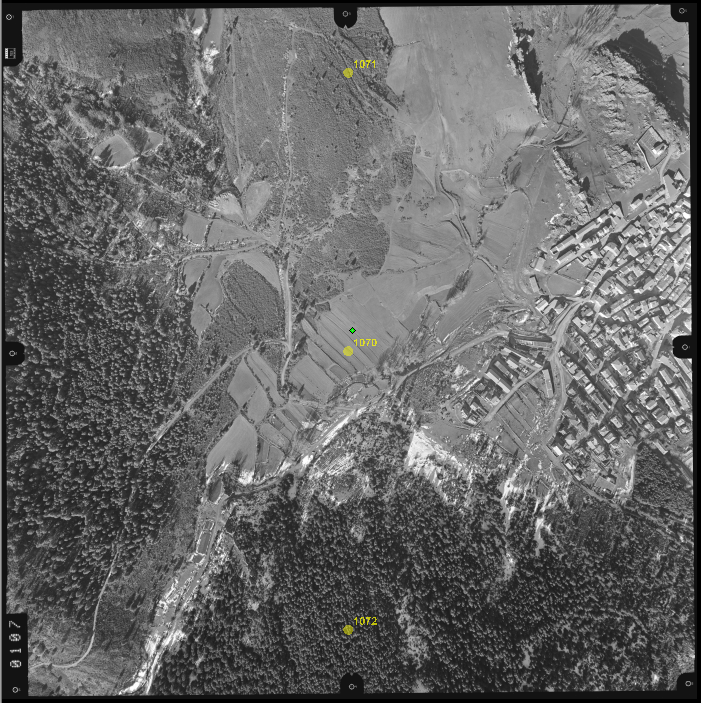
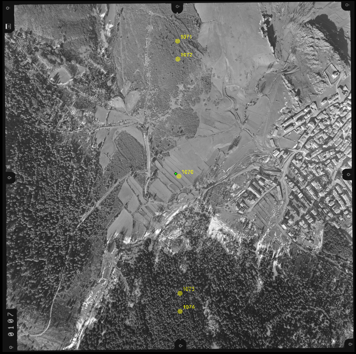

# Aerotriangulación manual
<!-- id: aerotriangulacion-manual -->

Digi3D.AI permite medir aerotriangulaciones de manera manual.

El programa numera automáticamente los puntos que debes medir y los localiza mediante correlación. Si la correlación localiza correctamente un punto, únicamente tienes que confirmar la medida realizada automáticamente.

Los conceptos teóricos de aerotriangulación están fuera del ámbito de este manual. Si no tienes conocimientos técnicos de aerotriangulación, consulta un libro de fotogrametría.

La medida de aerotriangulación en Digi3D.AI consiste en medir una serie de puntos repartidos por todo el proyecto. El proceso consiste en lo siguiente:

1. Localiza una ubicación donde medir un punto.
2. Asigna un nombre al punto.
3. Mide el punto en todos los modelos en los que aparezca.

Si el proyecto está formado por varias pasadas que forman un bloque, mide al menos tres puntos por foto. Si por el contrario está formado por una única pasada, o varias pasadas en las que el único solape entre pasadas es un único modelo (como por ejemplo una traza de carretera), mide al menos 5 puntos por foto. En un proyecto de una única pasada o con un único modelo de solape entre pasadas, medir únicamente tres puntos por foto puede producir, si una medida es incorrecta, un desdoblamiento en el cálculo, que puede no detectarse al analizar los resultados del programa de cálculo de aerotriangulación.

La siguiente imagen muestra la ubicación aproximada de los puntos cuando mides tres puntos por foto:

La siguiente imagen muestra la ubicación aproximada de los puntos cuando mides cinco puntos por foto:

Los puntos se miden en todos los modelos en los que entran, de modo que si el punto _1070_ solapa tanto con el modelo _107-108_ como con el modelo _108-109_, debes medir el punto en ambos modelos.

No puedes asignar el mismo nombre a dos puntos distintos; por tanto se suele utilizar como nombre del punto el nombre de la foto que lo aportó y un identificador del punto dentro de la foto.

En el ejemplo anterior (el de tres puntos) numera los puntos de la siguiente manera:

| Nombre del punto | Ubicación del punto           |
| ---------------- | ----------------------------- |
| 107 + 0 = 1070   | Centro de la foto 107         |
| 107 + 1 = 1071   | Parte superior de la foto 107 |
| 107 + 2 = 1072   | Parte inferior de la foto 107 |

Con esta numeración, el punto _1092_ está aportado por la foto _109_ y ubicado en la parte inferior de la foto _109_.
