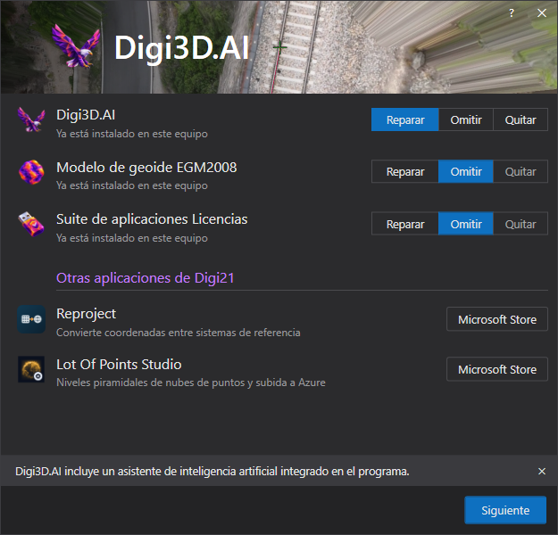

# Instalación de Digi3D.AI
<!-- id: instalacion-digi3d-ai -->

Para instalar Digi3D.AI, tan solo tienes que [descargar el instalador](https://www.digi21.net/Digi3D/Download) de nuestra página web.

El instalador es un _bootstrapper,_ un programa que ejecuta los instaladores de los componentes necesarios. El instalador de Digi3D.AI instala todos los componentes necesarios para el programa \(suite de licencias, controlador de la llave de protección, modelos de geoide, etc.\).

El instalador muestra una fila por componente: Digi3D.AI, el modelo de geoide EGM2008 y la suite de aplicaciones Licencias. Si un componente ya está instalado en el equipo, puedes **Reparar**lo, **Omitir**lo o **Quitar**lo. Pulsa **Siguiente** para aplicar las acciones que hayas elegido para cada componente.

En **Otras aplicaciones de Digi21**, el botón **Microsoft Store** abre la página de la tienda desde la que se instala cada aplicación:

* **Reproject**: convierte coordenadas entre sistemas de referencia.
* **Lot Of Points Studio**: genera niveles piramidales de nubes de puntos y los envía a Azure.

Una vez finalizada la instalación de Digi3D.AI, necesitas una licencia \(comprada, alquilada o de demostración\) para utilizar el programa. Consulta cómo obtener una licencia en [Acerca de las llaves de protección](/acerca-llaves-proteccion/).

