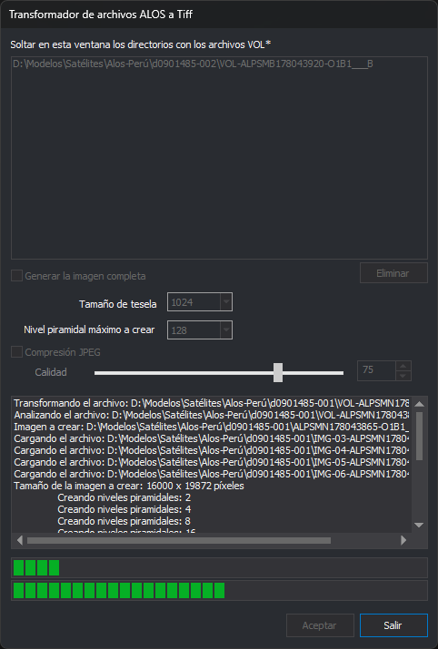

# Convertir imágenes ALOS a TIFF con Alos2Digi3D
<!-- id: convertir-imagenes-alos -->

El satélite ALOS (*Advanced Land Observing Satellite*), de la agencia espacial japonesa JAXA, lleva el sensor pancromático PRISM. JAXA distribuye las imágenes en formato CEOS, el formato de imágenes de satélite definido por el *Committee on Earth Observation Satellites*. Cada escena CEOS es una carpeta con varios archivos sin extensión, y el prefijo del nombre de cada archivo indica su contenido: `VOL-`, `IMG-`, `LED-`, `TRL-`...

Digi3D.AI no abre los archivos CEOS. El programa Alos2Digi3D convierte cada escena en un archivo TIFF por teselas y con niveles piramidales, que Digi3D.AI sí abre:

- Una **tesela** es un bloque cuadrado de la imagen, de tamaño fijo, que Digi3D.AI lee por separado.
- Un **nivel piramidal** es una copia de la imagen reducida a la mitad, a la cuarta parte, a la octava parte... Digi3D.AI elige el nivel piramidal según el zoom.

## Requisitos

- Una carpeta por escena PRISM, con estos archivos:
  - El archivo de volumen `VOL-<escena>-<producto>`. Alos2Digi3D solo usa el nombre de este archivo, no lee su contenido.
  - Al menos cuatro archivos de imagen `IMG-NN-<escena>-<producto>`, donde `NN` es el número de detector CCD, de `01` a `08`. `<escena>` y `<producto>` son el segundo y el tercer fragmento del nombre del archivo VOL, separados por guiones.

  Alos2Digi3D no lee los archivos `LED-`, `TRL-` ni el resto de archivos de la escena.
- Permiso de escritura en la carpeta de cada escena. Alos2Digi3D guarda el TIFF en esa carpeta.

Alos2Digi3D está preparado para las imágenes de PRISM, en las que cada archivo `IMG-NN` contiene la imagen de un detector CCD. Alos2Digi3D no trata las imágenes multiespectrales de AVNIR-2, el otro sensor óptico de ALOS: con una escena de AVNIR-2, Alos2Digi3D colocaría los archivos `IMG-NN` uno al lado de otro como si fueran detectores de PRISM.

## 1. Abrir Alos2Digi3D

1. Ejecuta `Alos2Digi3D.exe`, que está en la carpeta de instalación de Digi3D.AI (por defecto, `C:\Program Files\Digi21.net\Digi3D.AI`). Aparece el cuadro de diálogo **Transformador de archivos ALOS a Tiff**:

   

Alos2Digi3D muestra el cuadro de diálogo y sus mensajes en el idioma configurado en Digi3D.AI y usa el mismo tema de colores que Digi3D.AI. Algunas líneas de la zona de registro aparecen siempre en español, sea cual sea el idioma. El cuadro de diálogo se abre en la posición en la que se cerró la vez anterior.

## 2. Añadir las escenas a la lista

1. Abre el Explorador de archivos en la carpeta que contiene las carpetas de las escenas.
2. Selecciona una o varias carpetas de escena, arrástralas y suéltalas en la lista que hay debajo del texto **Soltar en esta ventana los directorios con los archivos VOL\***.

Alos2Digi3D busca en cada carpeta soltada los archivos sin extensión cuyo nombre empieza por `VOL` y añade a la lista la ruta completa de cada uno. Cada archivo VOL de la lista corresponde a una escena:

- Alos2Digi3D no busca en las subcarpetas de la carpeta soltada.
- Si sueltas un archivo en lugar de una carpeta, Alos2Digi3D no lo añade a la lista, aunque sea un archivo VOL.
- Si una carpeta no contiene ningún archivo VOL, Alos2Digi3D no añade nada a la lista y no muestra ningún mensaje.
- Si un archivo VOL ya está en la lista, Alos2Digi3D no lo añade otra vez.
- Mientras dura la conversión, Alos2Digi3D no añade a la lista las carpetas que se sueltan.

Alos2Digi3D no comprueba los archivos `IMG-NN` al añadir la escena a la lista. La comprobación se hace durante la conversión.

Para quitar una escena de la lista, selecciónala y pulsa **Eliminar**. La lista solo permite seleccionar una escena cada vez. El botón **Eliminar** está deshabilitado si no hay ninguna escena seleccionada.

## 3. Configurar la conversión

### Generar la imagen completa

Esta opción decide qué detectores abarca el TIFF. Por defecto está desactivada.

Las imágenes de dos detectores consecutivos se solapan 32 píxeles. Alos2Digi3D coloca cada imagen 32 píxeles antes del final de la anterior, y en la zona de solape el TIFF contiene los píxeles del detector de número mayor.

- **Desactivada**: el TIFF abarca desde el detector de número menor hasta el de número mayor de los que tiene la escena. Alos2Digi3D coloca las imágenes una a continuación de otra, sin tener en cuenta su número de detector, así que los detectores de la escena tienen que ser consecutivos.
- **Activada**: el TIFF abarca desde el detector 1 hasta el de número mayor de los que tiene la escena. Alos2Digi3D coloca cada imagen en la posición que corresponde a su número de detector, y la zona de los detectores que faltan queda en negro. Por ejemplo, si la escena tiene los archivos `IMG-03` a `IMG-06`, la zona de los detectores 1 y 2 queda en negro.

En los dos casos, Alos2Digi3D solo copia los píxeles de los cuatro archivos `IMG-NN` de número menor. Si la escena tiene más de cuatro, la zona de los demás detectores queda en negro.

### Tamaño del tile

Indica el tamaño en píxeles de las teselas: 64, 128, 256, 512, 1024, 2048 o 4096. El valor por defecto es 1024. Las teselas son cuadradas, y el tamaño se aplica a la imagen y a todos los niveles piramidales.

### Nivel piramidal máximo a crear

El desplegable ofrece los valores 2, 4, 8... hasta 8192. El valor por defecto es 128.

Alos2Digi3D no usa el valor de este desplegable: crea siempre siete niveles piramidales, con las reducciones 2, 4, 8, 16, 32, 64 y 128.

### Compresión JPEG

Activa esta opción para comprimir en JPEG los niveles piramidales. Por defecto está desactivada. La imagen a resolución completa se guarda siempre sin comprimir.

### Calidad

Indica la calidad del JPEG, entre 0 y 100, con la barra deslizante o con el cuadro de texto y sus flechas. El valor por defecto es 75. Cuanto mayor es la calidad, menos se comprimen los niveles piramidales. Los controles de **Calidad** solo están habilitados si **Compresión JPEG** está activada.

## 4. Convertir las escenas

1. Pulsa **Aceptar**. El botón **Aceptar** solo está habilitado si la lista tiene alguna escena.

Durante la conversión:

- La lista, **Eliminar**, **Aceptar** y todas las opciones de conversión quedan deshabilitados. **Salir** y la zona de registro siguen habilitados.
- Alos2Digi3D convierte las escenas en el orden de la lista. Cada escena desaparece de la lista al terminar, también si su conversión ha fallado.
- La zona de registro, el cuadro de texto que hay debajo de **Calidad**, muestra el archivo VOL que se está convirtiendo, la ruta del TIFF que se va a crear, cada archivo `IMG-NN` que se carga, el tamaño del TIFF en píxeles y cada nivel piramidal que se crea. Los errores también aparecen en la zona de registro (consulta [Mensajes de la zona de registro](#mensajes-de-la-zona-de-registro)).
- La primera barra de progreso muestra el avance de la fase en curso: primero la imagen a resolución completa y después cada nivel piramidal. La barra vuelve a cero al empezar cada nivel piramidal.
- La segunda barra de progreso no cambia durante la conversión.

Al terminar la lista, Alos2Digi3D muestra el mensaje **Trabajo finalizado satisfactoriamente**. Este mensaje aparece también cuando alguna escena ha fallado, así que revisa la zona de registro antes de cerrar el programa.

Si la conversión no llega a empezar, o se interrumpe por un error fuera de la conversión de una escena, Alos2Digi3D muestra el mensaje **La conversión se ha interrumpido por un error inesperado. Los archivos que quedan en la lista no se han procesado.**

### Cancelar la conversión

Pulsa **Salir** o la tecla Esc. Si hay una conversión en marcha, Alos2Digi3D la detiene, borra el TIFF de la escena que estaba convirtiendo y se cierra. Los TIFF de las escenas ya terminadas se conservan.

## 5. Resultado

Alos2Digi3D crea un archivo TIFF por escena:

- El TIFF se guarda en la carpeta de la escena.
- El nombre del TIFF es el del archivo VOL sin sus cuatro primeros caracteres, que son el prefijo `VOL-`, y con la extensión `.tif`. Por ejemplo, el archivo `VOL-<escena>-<producto>` produce el archivo `<escena>-<producto>.tif`.
- Si el TIFF ya existe, Alos2Digi3D lo sobrescribe.
- El TIFF es un BigTIFF, la variante del formato TIFF que admite archivos de más de 4 GB.
- El TIFF tiene un solo canal, en escala de grises.
- El TIFF contiene la imagen a resolución completa y, a continuación, los siete niveles piramidales dentro del mismo archivo.
- El TIFF está girado 90 grados en sentido contrario a las agujas del reloj respecto a los archivos `IMG-NN`: cada línea de los archivos `IMG-NN` es una columna del TIFF, y el detector de número menor queda en la parte inferior. El ancho del TIFF es el número de líneas de los archivos `IMG-NN`.

Alos2Digi3D no genera ningún otro archivo: ni archivo de georreferencia, ni orientación, ni coeficientes RPC.

## 6. Usar los TIFF en Digi3D.AI

Los TIFF ya tienen teselas y niveles piramidales, así que no hace falta procesarlos con el [Generador de Niveles Piramidales](/digi3d-ai/referencia/generador-de-niveles-piramidales.md).

Los TIFF no tienen georreferencia ni orientación. Ninguna de las [extensiones del sensor Satélite RPC](/digi3d-ai/referencia/ventana-fotogrametrica/sensores/rpc/extensiones/README.md) lee los archivos de una escena ALOS, así que para orientar el TIFF en la ventana fotogramétrica hay que disponer de la orientación en uno de los formatos que admiten esas extensiones. Esa orientación tiene que corresponder a la imagen girada que genera Alos2Digi3D.

## Mensajes de la zona de registro

| Mensaje | Causa |
| :--- | :--- |
| La escena *archivo VOL* solo tiene *n* de las 4 imágenes de sensor esperadas | La carpeta tiene menos de cuatro archivos `IMG-NN` con el mismo `<escena>` y `<producto>` que el archivo VOL. Si el nombre del archivo VOL no tiene tres fragmentos separados por guiones, *n* vale 0. |
| El archivo *archivo IMG* no tiene el formato CEOS esperado (campo *campo*) | Un campo de la cabecera del archivo `IMG-NN` no tiene el valor que exige el formato CEOS. El mensaje da el nombre del campo en inglés, como la especificación del formato. |
| No soportado imágenes con mas de un canal | Un archivo `IMG-NN` no tiene exactamente una banda. |
| La conversión se ha interrumpido por un error inesperado. Los archivos que quedan en la lista no se han procesado. | Los cuatro archivos `IMG-NN` de número menor no tienen el mismo número de píxeles por línea, o ese número es de 32 o menos. A pesar del texto del mensaje, Alos2Digi3D continúa con la escena siguiente. |
| No se pudo leer el archivo *archivo VOL*: *motivo* | Alos2Digi3D no ha podido abrir o leer uno de los archivos `IMG-NN` de la escena. El mensaje da la ruta del archivo VOL, no la del archivo `IMG-NN`, y el motivo del error. |
| Error al crear el archivo: *archivo TIFF* | Alos2Digi3D no ha podido crear el TIFF, por ejemplo porque la carpeta no tiene permiso de escritura. |
| Error inesperado al procesar el archivo *archivo VOL*: *motivo* | Error no previsto durante la conversión de la escena. |
| Error inesperado al procesar el archivo *archivo VOL* | Error no previsto y sin descripción durante la conversión de la escena. |

En todos los casos, Alos2Digi3D continúa con la escena siguiente. Con los cuatro primeros mensajes de la tabla y con **Error al crear el archivo**, Alos2Digi3D no llega a crear el TIFF de la escena. Con **No se pudo leer el archivo** y con los dos mensajes de error inesperado, el TIFF incompleto de la escena puede quedar en su carpeta si el error se produce después de crearlo.

## Véase también

- [Generador de Niveles Piramidales](/digi3d-ai/referencia/generador-de-niveles-piramidales.md): crea teselas y niveles piramidales de imágenes TIFF.
- [Satélite RPC](/digi3d-ai/referencia/ventana-fotogrametrica/sensores/rpc/README.md): sensor para imágenes de satélite con coeficientes RPC.
