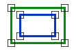

# CompletelyWithin
<!-- id: completelywithin -->

Espacio de nombres: [Digi21.DigiNG.Entities.Relations](/digi3d-ai/programacion/.net/referencia/digi21.diging/digi21.diging.entities.relations/)  
Ensamblado: [Digi21.DigiNG](/digi3d-ai/programacion/.net/referencia/digi21.diging/)

Indica si la primera área está completamente dentro de la segunda, sin vértices comunes.



```csharp
public static bool CompletelyWithin(ReadOnlyLine a, ReadOnlyLine b)
public static bool CompletelyWithin(ReadOnlyLine a, ReadOnlyPolygon b)
public static bool CompletelyWithin(ReadOnlyPolygon a, ReadOnlyLine b)
public static bool CompletelyWithin(ReadOnlyPolygon a, ReadOnlyPolygon b)
```

| Parámetro | Descripción |
| :--- | :--- |
| `a` | Área que se comprueba si está dentro de `b`: una [ReadOnlyLine](/digi3d-ai/programacion/.net/referencia/digi21.diging/digi21.diging.entities/clases/readonlyline/) cerrada o un [ReadOnlyPolygon](/digi3d-ai/programacion/.net/referencia/digi21.diging/digi21.diging.entities/clases/readonlypolygon/). |
| `b` | Área contenedora. |

## Valor devuelto

`true` si se cumplen las cuatro condiciones:

* Ningún vértice de `a` está fuera de `b`. Un vértice dentro de un hueco de `b` está fuera de `b`.
* Al menos un vértice de `a` está dentro de `b`. Los vértices de `a` que están sobre un lado de `b` se ignoran.
* Ningún vértice de `a` coincide con un vértice de `b`.
* Ningún vértice de `b`, huecos incluidos, está dentro de `a`.

Si `a` está dentro de `b` con algún vértice común, este método devuelve `false` y [Within](/digi3d-ai/programacion/.net/referencia/digi21.diging/digi21.diging.entities.relations/clases/areaarea/metodos-estaticos/within.md)`(a, b)` devuelve `true`. El método no es simétrico: para saber si `b` está completamente dentro de `a`, llama a `CompletelyWithin(b, a)`.

## Excepciones

| Excepción | Cuándo |
| :--- | :--- |
| `ArgumentNullException` | `a` o `b` es `null`. |
| `SEHException` | Un área tiene un anillo sin cerrar, de área nula o con una espiga. Lee las [excepciones de AreaArea](/digi3d-ai/programacion/.net/referencia/digi21.diging/digi21.diging.entities.relations/clases/areaarea/#excepciones). |

## Ejemplo

Lee el [ejemplo de AreaArea](/digi3d-ai/programacion/.net/referencia/digi21.diging/digi21.diging.entities.relations/clases/areaarea/#ejemplo).
