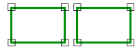

# Disjoint
<!-- id: disjoint -->

Espacio de nombres: [Digi21.DigiNG.Entities.Relations](/digi3d-ai/programacion/.net/referencia/digi21.diging/digi21.diging.entities.relations/)  
Ensamblado: [Digi21.DigiNG](/digi3d-ai/programacion/.net/referencia/digi21.diging/)

Indica si dos áreas son disjuntas.



```csharp
public static bool Disjoint(ReadOnlyLine a, ReadOnlyLine b)
public static bool Disjoint(ReadOnlyLine a, ReadOnlyPolygon b)
public static bool Disjoint(ReadOnlyPolygon a, ReadOnlyLine b)
public static bool Disjoint(ReadOnlyPolygon a, ReadOnlyPolygon b)
```

| Parámetro | Descripción |
| :--- | :--- |
| `a` | Primera área: una [ReadOnlyLine](/digi3d-ai/programacion/.net/referencia/digi21.diging/digi21.diging.entities/clases/readonlyline/) cerrada o un [ReadOnlyPolygon](/digi3d-ai/programacion/.net/referencia/digi21.diging/digi21.diging.entities/clases/readonlypolygon/). |
| `b` | Segunda área. |

## Valor devuelto

`true` si las áreas no son iguales y se cumple una de estas condiciones:

* Las cajas envolventes en planta de las dos áreas no se tocan.
* Las áreas no tienen vértices comunes y ningún vértice de un área está dentro de la otra.

Un vértice que está dentro de un hueco de la otra área cuenta como fuera, así que un área dentro de un hueco de un polígono es disjunta de ese polígono si no comparte vértices con el hueco.

Como el método solo analiza vértices, dos áreas que se cruzan sin tener vértices dentro de la otra ni vértices comunes también son disjuntas.

## Excepciones

| Excepción | Cuándo |
| :--- | :--- |
| `ArgumentNullException` | `a` o `b` es `null`. |
| `SEHException` | Un área tiene un anillo sin cerrar, de área nula o con una espiga. Lee las [excepciones de AreaArea](/digi3d-ai/programacion/.net/referencia/digi21.diging/digi21.diging.entities.relations/clases/areaarea/#excepciones). |

## Ejemplo

Lee el [ejemplo de AreaArea](/digi3d-ai/programacion/.net/referencia/digi21.diging/digi21.diging.entities.relations/clases/areaarea/#ejemplo).
