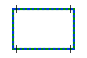

# Equal
<!-- id: equal -->

Espacio de nombres: [Digi21.DigiNG.Entities.Relations](/digi3d-ai/programacion/.net/referencia/digi21.diging/digi21.diging.entities.relations/)  
Ensamblado: [Digi21.DigiNG](/digi3d-ai/programacion/.net/referencia/digi21.diging/)

Indica si dos áreas son iguales.



```csharp
public static bool Equal(ReadOnlyLine a, ReadOnlyLine b)
public static bool Equal(ReadOnlyLine a, ReadOnlyPolygon b)
public static bool Equal(ReadOnlyPolygon a, ReadOnlyLine b)
public static bool Equal(ReadOnlyPolygon a, ReadOnlyPolygon b)
```

| Parámetro | Descripción |
| :--- | :--- |
| `a` | Primera área: una [ReadOnlyLine](/digi3d-ai/programacion/.net/referencia/digi21.diging/digi21.diging.entities/clases/readonlyline/) cerrada o un [ReadOnlyPolygon](/digi3d-ai/programacion/.net/referencia/digi21.diging/digi21.diging.entities/clases/readonlypolygon/). |
| `b` | Segunda área. |

## Valor devuelto

`true` si se cumple una de estas condiciones:

* Los anillos exteriores tienen los mismos vértices en el mismo orden circular, con cualquier vértice inicial y en cualquier sentido, y cada hueco de `a` es igual a un hueco de `b` con la misma regla. Las dos áreas tienen el mismo número de huecos. Antes de comparar se quitan el vértice de cierre y los vértices repetidos consecutivos.
* Las áreas tienen vértices comunes y ningún vértice de un área está dentro ni fuera de la otra: los vértices que no son comunes están sobre los lados de la otra área. Así, un área es igual a otra con el mismo contorno y vértices intermedios en los lados.

Una [ReadOnlyLine](/digi3d-ai/programacion/.net/referencia/digi21.diging/digi21.diging.entities/clases/readonlyline/) cerrada puede ser igual a un [ReadOnlyPolygon](/digi3d-ai/programacion/.net/referencia/digi21.diging/digi21.diging.entities/clases/readonlypolygon/) sin huecos. La coordenada Z, los códigos y los atributos no se comparan.

## Excepciones

| Excepción | Cuándo |
| :--- | :--- |
| `ArgumentNullException` | `a` o `b` es `null`. |
| `SEHException` | Un área tiene un anillo sin cerrar, de área nula o con una espiga. Lee las [excepciones de AreaArea](/digi3d-ai/programacion/.net/referencia/digi21.diging/digi21.diging.entities.relations/clases/areaarea/#excepciones). |
