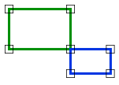
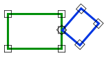

# Join
<!-- id: join -->

Espacio de nombres: [Digi21.DigiNG.Entities.Relations](/digi3d-ai/programacion/.net/referencia/digi21.diging/digi21.diging.entities.relations/)  
Ensamblado: [Digi21.DigiNG](/digi3d-ai/programacion/.net/referencia/digi21.diging/)

Indica si dos áreas tienen un punto de unión: se tocan en vértices comunes sin compartir ningún lado.





```csharp
public static bool Join(ReadOnlyLine a, ReadOnlyLine b)
public static bool Join(ReadOnlyLine a, ReadOnlyPolygon b)
public static bool Join(ReadOnlyPolygon a, ReadOnlyLine b)
public static bool Join(ReadOnlyPolygon a, ReadOnlyPolygon b)
```

| Parámetro | Descripción |
| :--- | :--- |
| `a` | Primera área: una [ReadOnlyLine](/digi3d-ai/programacion/.net/referencia/digi21.diging/digi21.diging.entities/clases/readonlyline/) cerrada o un [ReadOnlyPolygon](/digi3d-ai/programacion/.net/referencia/digi21.diging/digi21.diging.entities/clases/readonlypolygon/). |
| `b` | Segunda área. |

## Valor devuelto

`true` si se cumplen las tres condiciones:

* Ningún vértice de `a` está dentro de `b` y ningún vértice de `b` está dentro de `a`.
* Las dos áreas tienen al menos un vértice común.
* Ningún lado de un anillo de `a` es también un lado de un anillo de `b`. Si comparten un lado, devuelve `true` el método [Adjacent](/digi3d-ai/programacion/.net/referencia/digi21.diging/digi21.diging.entities.relations/clases/areaarea/metodos-estaticos/adjacent.md).

Si todos los vértices de un área son comunes o están sobre los lados de la otra, el resultado depende de un punto interior de esa área: si el punto está dentro de la otra área, el método devuelve `false` y [Within](/digi3d-ai/programacion/.net/referencia/digi21.diging/digi21.diging.entities.relations/clases/areaarea/metodos-estaticos/within.md) devuelve `true`.

## Excepciones

| Excepción | Cuándo |
| :--- | :--- |
| `ArgumentNullException` | `a` o `b` es `null`. |
| `SEHException` | Un área tiene un anillo sin cerrar, de área nula o con una espiga. Lee las [excepciones de AreaArea](/digi3d-ai/programacion/.net/referencia/digi21.diging/digi21.diging.entities.relations/clases/areaarea/#excepciones). |
