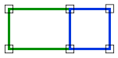

# OuterRingAdjacent
<!-- id: outerringadjacent -->

Espacio de nombres: [Digi21.DigiNG.Entities.Relations](/digi3d-ai/programacion/.net/referencia/digi21.diging/digi21.diging.entities.relations/)  
Ensamblado: [Digi21.DigiNG](/digi3d-ai/programacion/.net/referencia/digi21.diging/)

Indica si dos áreas son adyacentes.



```csharp
public static bool OuterRingAdjacent(ReadOnlyLine a, ReadOnlyPolygon b)
public static bool OuterRingAdjacent(ReadOnlyPolygon a, ReadOnlyLine b)
public static bool OuterRingAdjacent(ReadOnlyPolygon a, ReadOnlyPolygon b)
```

| Parámetro | Descripción |
| :--- | :--- |
| `a` | Primera área: una [ReadOnlyLine](/digi3d-ai/programacion/.net/referencia/digi21.diging/digi21.diging.entities/clases/readonlyline/) cerrada o un [ReadOnlyPolygon](/digi3d-ai/programacion/.net/referencia/digi21.diging/digi21.diging.entities/clases/readonlypolygon/). |
| `b` | Segunda área. |

## Valor devuelto

El valor que devuelve [Adjacent](/digi3d-ai/programacion/.net/referencia/digi21.diging/digi21.diging.entities.relations/clases/areaarea/metodos-estaticos/adjacent.md) si cada `ReadOnlyPolygon` se sustituye por una línea cerrada con los vértices de su anillo exterior. Los huecos de los polígonos no intervienen: un área adyacente solo a un hueco de un polígono no es adyacente a ese polígono.

## Excepciones

| Excepción | Cuándo |
| :--- | :--- |
| `ArgumentNullException` | `a` o `b` es `null`. |
| `SEHException` | Un área tiene un anillo sin cerrar, de área nula o con una espiga. Lee las [excepciones de AreaArea](/digi3d-ai/programacion/.net/referencia/digi21.diging/digi21.diging.entities.relations/clases/areaarea/#excepciones). |
