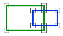
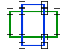

# Overlap
<!-- id: overlap -->

Espacio de nombres: [Digi21.DigiNG.Entities.Relations](/digi3d-ai/programacion/.net/referencia/digi21.diging/digi21.diging.entities.relations/)  
Ensamblado: [Digi21.DigiNG](/digi3d-ai/programacion/.net/referencia/digi21.diging/)

Indica si dos áreas se solapan y devuelve un vértice de un área que está dentro de la otra.





```csharp
public static bool Overlap(ReadOnlyLine a, ReadOnlyLine b, out Point3D coordinate)
public static bool Overlap(ReadOnlyLine a, ReadOnlyPolygon b, out Point3D coordinate)
public static bool Overlap(ReadOnlyPolygon a, ReadOnlyLine b, out Point3D coordinate)
public static bool Overlap(ReadOnlyPolygon a, ReadOnlyPolygon b, out Point3D coordinate)
```

| Parámetro | Descripción |
| :--- | :--- |
| `a` | Primera área: una [ReadOnlyLine](/digi3d-ai/programacion/.net/referencia/digi21.diging/digi21.diging.entities/clases/readonlyline/) cerrada o un [ReadOnlyPolygon](/digi3d-ai/programacion/.net/referencia/digi21.diging/digi21.diging.entities/clases/readonlypolygon/). |
| `b` | Segunda área. |
| `coordinate` | Parámetro de salida de tipo [Point3D](/digi3d-ai/programacion/.net/referencia/digi21.diging/digi21.math/clases/point3d.md). Si el método devuelve `true`, contiene el primer vértice de `a` que está dentro de `b` o, si ningún vértice de `a` está dentro de `b`, el primer vértice de `b` que está dentro de `a`, con su coordenada Z. Si el método devuelve `false`, contiene (0, 0, 0). Sirve, por ejemplo, para señalar al usuario el lugar del solape. |

## Valor devuelto

`true` si las áreas no cumplen ninguna de las otras relaciones de [AreaArea](/digi3d-ai/programacion/.net/referencia/digi21.diging/digi21.diging.entities.relations/clases/areaarea/): hay vértices de un área dentro de la otra y ninguna de las dos contiene a la otra. Por ejemplo, `a` tiene vértices dentro y fuera de `b`, y `b` tiene algún vértice dentro de `a`.

Como el método solo analiza vértices, dos áreas cuyos lados se cruzan sin que ningún vértice de una quede dentro de la otra no se solapan: [Disjoint](/digi3d-ai/programacion/.net/referencia/digi21.diging/digi21.diging.entities.relations/clases/areaarea/metodos-estaticos/disjoint.md) devuelve `true` si además no tienen vértices comunes.

## Excepciones

| Excepción | Cuándo |
| :--- | :--- |
| `ArgumentNullException` | `a` o `b` es `null`. |
| `SEHException` | Un área tiene un anillo sin cerrar, de área nula o con una espiga. Lee las [excepciones de AreaArea](/digi3d-ai/programacion/.net/referencia/digi21.diging/digi21.diging.entities.relations/clases/areaarea/#excepciones). |

## Ejemplo

Lee el [ejemplo de AreaArea](/digi3d-ai/programacion/.net/referencia/digi21.diging/digi21.diging.entities.relations/clases/areaarea/#ejemplo).
