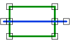
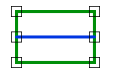

# Across
<!-- id: across -->

Espacio de nombres: [Digi21.DigiNG.Entities.Relations](/digi3d-ai/programacion/.net/referencia/digi21.diging/digi21.diging.entities.relations/)  
Ensamblado: [Digi21.DigiNG](/digi3d-ai/programacion/.net/referencia/digi21.diging/)

Indica si la línea cruza el área: entra por un punto del borde y sale por otro pasando por el interior.





```csharp
public static bool Across(ReadOnlyLine line, ReadOnlyLine area)
public static bool Across(ReadOnlyLine line, ReadOnlyPolygon area)
```

| Parámetro | Descripción |
| :--- | :--- |
| `line` | Línea. |
| `area` | Área: una [ReadOnlyLine](/digi3d-ai/programacion/.net/referencia/digi21.diging/digi21.diging.entities/clases/readonlyline/) cerrada o un [ReadOnlyPolygon](/digi3d-ai/programacion/.net/referencia/digi21.diging/digi21.diging.entities/clases/readonlypolygon/). |

## Valor devuelto

El método recorre los vértices de `line` y toma los que están sobre el borde del área (sobre un vértice o sobre un lado). Para cada dos de esos vértices consecutivos en el recorrido, con índices `i` y `j` (`i < j`), comprueba un punto de la línea:

* Si `j = i + 1`, el punto medio del lado de la línea entre los dos vértices.
* Si no, el vértice `j - 1`.

Devuelve `true` en cuanto uno de esos puntos está dentro del área. Con un `ReadOnlyPolygon`, el borde incluye los huecos y un punto dentro de un hueco no está dentro del área.

Una línea que cruza el borde sin tener un vértice sobre él no se detecta. Tampoco se detecta una línea que tiene un solo vértice sobre el borde.

## Excepciones

| Excepción | Cuándo |
| :--- | :--- |
| `ArgumentNullException` | `line` o `area` es `null`. |

## Ejemplo

Lee el [ejemplo de LineArea](/digi3d-ai/programacion/.net/referencia/digi21.diging/digi21.diging.entities.relations/clases/linearea/#ejemplo).
