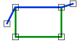

# Adjacent
<!-- id: adjacent-2 -->

Espacio de nombres: [Digi21.DigiNG.Entities.Relations](/digi3d-ai/programacion/.net/referencia/digi21.diging/digi21.diging.entities.relations/)  
Ensamblado: [Digi21.DigiNG](/digi3d-ai/programacion/.net/referencia/digi21.diging/)

Indica si la línea es adyacente al área: la línea recorre parte del borde del área sin entrar en el área.



```csharp
public static bool Adjacent(ReadOnlyLine line, ReadOnlyLine area)
public static bool Adjacent(ReadOnlyLine line, ReadOnlyPolygon area)
```

| Parámetro | Descripción |
| :--- | :--- |
| `line` | Línea. |
| `area` | Área: una [ReadOnlyLine](/digi3d-ai/programacion/.net/referencia/digi21.diging/digi21.diging.entities/clases/readonlyline/) cerrada o un [ReadOnlyPolygon](/digi3d-ai/programacion/.net/referencia/digi21.diging/digi21.diging.entities/clases/readonlypolygon/). |

## Valor devuelto

`true` si se cumplen las dos condiciones:

* La línea comparte al menos un lado con el área: dos vértices consecutivos de la línea coinciden con dos vértices consecutivos del área. Con un `ReadOnlyPolygon`, el lado puede ser del anillo exterior o de un hueco.
* Ningún vértice de la línea está dentro del área. Los vértices fuera del área o sobre el borde están permitidos.

## Excepciones

| Excepción | Cuándo |
| :--- | :--- |
| `ArgumentNullException` | `line` o `area` es `null`. |

## Ejemplo

Lee el [ejemplo de LineArea](/digi3d-ai/programacion/.net/referencia/digi21.diging/digi21.diging.entities.relations/clases/linearea/#ejemplo).
