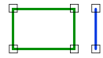

# Disjoint
<!-- id: disjoint-2 -->

Espacio de nombres: [Digi21.DigiNG.Entities.Relations](/digi3d-ai/programacion/.net/referencia/digi21.diging/digi21.diging.entities.relations/)  
Ensamblado: [Digi21.DigiNG](/digi3d-ai/programacion/.net/referencia/digi21.diging/)

Indica si la línea y el área son disjuntas.



```csharp
public static bool Disjoint(ReadOnlyLine line, ReadOnlyLine area)
public static bool Disjoint(ReadOnlyLine line, ReadOnlyPolygon area)
```

| Parámetro | Descripción |
| :--- | :--- |
| `line` | Línea. |
| `area` | Área: una [ReadOnlyLine](/digi3d-ai/programacion/.net/referencia/digi21.diging/digi21.diging.entities/clases/readonlyline/) cerrada o un [ReadOnlyPolygon](/digi3d-ai/programacion/.net/referencia/digi21.diging/digi21.diging.entities/clases/readonlypolygon/). |

## Valor devuelto

### Disjoint(ReadOnlyLine, ReadOnlyLine)

`true` si se cumplen las dos condiciones:

* Ningún vértice de `line` coincide con un vértice de `area`, o las cajas envolventes en planta no se tocan.
* No todos los vértices de `line` están dentro de `area`.

La sobrecarga solo descarta las líneas con todos sus vértices dentro del área. Una línea con unos vértices dentro y otros fuera, sin vértices comunes con el área, también devuelve `true`.

### Disjoint(ReadOnlyLine, ReadOnlyPolygon)

> En la versión 26.0.0, esta sobrecarga devuelve `true` solo si se cumplen las cuatro condiciones siguientes, y `false` en cualquier otro caso:
>
> * Las cajas envolventes en planta de la línea y del polígono se tocan.
> * Ningún vértice de la línea coincide con un vértice del anillo exterior.
> * Para algún hueco del polígono, [Join](/digi3d-ai/programacion/.net/referencia/digi21.diging/digi21.diging.entities.relations/clases/linearea/metodos-estaticos/join.md)`(line, hueco)` devuelve `true`.
> * No todos los vértices de la línea están dentro del polígono.
>
> Por tanto, con un polígono sin huecos o con una línea alejada del polígono, la sobrecarga devuelve `false`.

## Excepciones

| Excepción | Cuándo |
| :--- | :--- |
| `ArgumentNullException` | `line` o `area` es `null`. |
