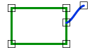

# EndpointJoin
<!-- id: endpointjoin -->

Espacio de nombres: [Digi21.DigiNG.Entities.Relations](/digi3d-ai/programacion/.net/referencia/digi21.diging/digi21.diging.entities.relations/)  
Ensamblado: [Digi21.DigiNG](/digi3d-ai/programacion/.net/referencia/digi21.diging/)

Indica si uno de los extremos de la línea se une con el área en un vértice del área.



```csharp
public static bool EndpointJoin(ReadOnlyLine line, ReadOnlyLine area)
public static bool EndpointJoin(ReadOnlyLine line, ReadOnlyPolygon area)
```

| Parámetro | Descripción |
| :--- | :--- |
| `line` | Línea. |
| `area` | Área: una [ReadOnlyLine](/digi3d-ai/programacion/.net/referencia/digi21.diging/digi21.diging.entities/clases/readonlyline/) cerrada o un [ReadOnlyPolygon](/digi3d-ai/programacion/.net/referencia/digi21.diging/digi21.diging.entities/clases/readonlypolygon/). |

## Valor devuelto

* `EndpointJoin(ReadOnlyLine, ReadOnlyLine)`: `true` si el primer o el último vértice de `line` coincide con un vértice de `area`.
* `EndpointJoin(ReadOnlyLine, ReadOnlyPolygon)`: `true` si el primer o el último vértice de `line` coincide con un vértice del anillo exterior o de un hueco, y además [Across](/digi3d-ai/programacion/.net/referencia/digi21.diging/digi21.diging.entities.relations/clases/linearea/metodos-estaticos/across.md)`(line, area)` devuelve `false`.

Un extremo de la línea situado sobre un lado del área, sin coincidir con un vértice, no cuenta. El resto de la línea no se analiza en la primera sobrecarga: la línea puede tener vértices dentro del área.

## Excepciones

| Excepción | Cuándo |
| :--- | :--- |
| `ArgumentNullException` | `line` o `area` es `null`. |

## Ejemplo

Lee el [ejemplo de LineArea](/digi3d-ai/programacion/.net/referencia/digi21.diging/digi21.diging.entities.relations/clases/linearea/#ejemplo).
