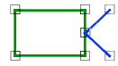

# Join
<!-- id: join-2 -->

Espacio de nombres: [Digi21.DigiNG.Entities.Relations](/digi3d-ai/programacion/.net/referencia/digi21.diging/digi21.diging.entities.relations/)  
Ensamblado: [Digi21.DigiNG](/digi3d-ai/programacion/.net/referencia/digi21.diging/)

Indica si la línea toca el área en un vértice intermedio de la línea, sin recorrer el borde ni cruzarlo.



```csharp
public static bool Join(ReadOnlyLine line, ReadOnlyLine area)
public static bool Join(ReadOnlyLine line, ReadOnlyPolygon area)
```

| Parámetro | Descripción |
| :--- | :--- |
| `line` | Línea. |
| `area` | Área: una [ReadOnlyLine](/digi3d-ai/programacion/.net/referencia/digi21.diging/digi21.diging.entities/clases/readonlyline/) cerrada o un [ReadOnlyPolygon](/digi3d-ai/programacion/.net/referencia/digi21.diging/digi21.diging.entities/clases/readonlypolygon/). |

## Valor devuelto

`Join(ReadOnlyLine, ReadOnlyLine)` devuelve `true` si se cumplen las tres condiciones:

* Un vértice intermedio de `line` (ni el primero ni el último) coincide con un vértice de `area`.
* La línea no comparte ningún lado con el área: no hay dos vértices consecutivos de la línea que coincidan con dos vértices consecutivos del área.
* La línea no cruza el borde del área en un vértice común. Solo se analiza el primer vértice intermedio de la línea que coincide con un vértice del área distinto del primero y del último del área. En ese vértice, la línea cruza si los vértices vecinos de cada entidad quedan a lados distintos del lado de la otra entidad que sale de ese vértice.

`Join(ReadOnlyLine, ReadOnlyPolygon)` devuelve `true` si las tres condiciones se cumplen con el anillo exterior del polígono o con alguno de sus huecos.

Si solo coincide un extremo de la línea, el método devuelve `false`; para ese caso usa [EndpointJoin](/digi3d-ai/programacion/.net/referencia/digi21.diging/digi21.diging.entities.relations/clases/linearea/metodos-estaticos/endpointjoin.md).

## Excepciones

| Excepción | Cuándo |
| :--- | :--- |
| `ArgumentNullException` | `line` o `area` es `null`. |
