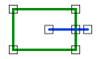

# TerminatesWithin
<!-- id: terminateswithin -->

Espacio de nombres: [Digi21.DigiNG.Entities.Relations](/digi3d-ai/programacion/.net/referencia/digi21.diging/digi21.diging.entities.relations/)  
Ensamblado: [Digi21.DigiNG](/digi3d-ai/programacion/.net/referencia/digi21.diging/)

Indica si la línea entra en el área desde fuera y termina dentro de ella.



```csharp
public static bool TerminatesWithin(ReadOnlyLine line, ReadOnlyLine area)
public static bool TerminatesWithin(ReadOnlyLine line, ReadOnlyPolygon area)
```

| Parámetro | Descripción |
| :--- | :--- |
| `line` | Línea. |
| `area` | Área: una [ReadOnlyLine](/digi3d-ai/programacion/.net/referencia/digi21.diging/digi21.diging.entities/clases/readonlyline/) cerrada o un [ReadOnlyPolygon](/digi3d-ai/programacion/.net/referencia/digi21.diging/digi21.diging.entities/clases/readonlypolygon/). |

## Valor devuelto

`true` si se cumplen las dos condiciones:

* Al menos un vértice de la línea está fuera del área. Un vértice dentro de un hueco de un polígono está fuera.
* El primer o el último vértice de la línea está dentro del área.

Los vértices situados sobre el borde no cuentan como dentro ni como fuera. Una línea con los dos extremos dentro y algún vértice intermedio fuera también devuelve `true`.

## Excepciones

| Excepción | Cuándo |
| :--- | :--- |
| `ArgumentNullException` | `line` o `area` es `null`. |

## Ejemplo

Lee el [ejemplo de LineArea](/digi3d-ai/programacion/.net/referencia/digi21.diging/digi21.diging.entities.relations/clases/linearea/#ejemplo).
