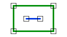

# Within
<!-- id: within-2 -->

Espacio de nombres: [Digi21.DigiNG.Entities.Relations](/digi3d-ai/programacion/.net/referencia/digi21.diging/digi21.diging.entities.relations/)  
Ensamblado: [Digi21.DigiNG](/digi3d-ai/programacion/.net/referencia/digi21.diging/)

Indica si la línea está dentro del área.



```csharp
public static bool Within(ReadOnlyLine line, ReadOnlyLine area)
public static bool Within(ReadOnlyLine line, ReadOnlyPolygon area)
```

| Parámetro | Descripción |
| :--- | :--- |
| `line` | Línea. |
| `area` | Área: una [ReadOnlyLine](/digi3d-ai/programacion/.net/referencia/digi21.diging/digi21.diging.entities/clases/readonlyline/) cerrada o un [ReadOnlyPolygon](/digi3d-ai/programacion/.net/referencia/digi21.diging/digi21.diging.entities/clases/readonlypolygon/). |

## Valor devuelto

`true` si todos los vértices de la línea están dentro del área. Un vértice sobre el borde o dentro de un hueco de un polígono no está dentro, así que el método devuelve `false` si la línea toca el borde.

Como solo se analizan los vértices, el método devuelve `true` aunque un lado de la línea salga del área entre dos vértices interiores, por ejemplo al atravesar una entrante del contorno o un hueco.

## Excepciones

| Excepción | Cuándo |
| :--- | :--- |
| `ArgumentNullException` | `line` o `area` es `null`. |

## Ejemplo

Lee el [ejemplo de LineArea](/digi3d-ai/programacion/.net/referencia/digi21.diging/digi21.diging.entities.relations/clases/linearea/#ejemplo).
