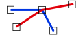

# Across
<!-- id: across-2 -->

Espacio de nombres: [Digi21.DigiNG.Entities.Relations](/digi3d-ai/programacion/.net/referencia/digi21.diging/digi21.diging.entities.relations/)  
Ensamblado: [Digi21.DigiNG](/digi3d-ai/programacion/.net/referencia/digi21.diging/)

Indica si las dos líneas se cruzan en un vértice común.



```csharp
public static bool Across(ReadOnlyLine a, ReadOnlyLine b)
```

| Parámetro | Descripción |
| :--- | :--- |
| `a` | Primera línea, de tipo [ReadOnlyLine](/digi3d-ai/programacion/.net/referencia/digi21.diging/digi21.diging.entities/clases/readonlyline/). |
| `b` | Segunda línea. |

## Valor devuelto

`true` si existe un vértice intermedio de `a` que coincide con un vértice intermedio de `b` y en el que las dos líneas se cruzan. En ese vértice, las líneas se cruzan si se cumplen las dos condiciones:

* El vértice anterior y el siguiente de `b` quedan a lados distintos del lado de `a` que sale del vértice común.
* El vértice anterior y el siguiente de `a` quedan a lados distintos del lado de `b` que sale del vértice común.

Si un vértice intermedio de `a` coincide con varios vértices intermedios de `b`, solo se analiza el primero. Un cruce entre lados sin vértice común no se detecta, y tampoco un cruce en un extremo de una de las líneas.

## Excepciones

| Excepción | Cuándo |
| :--- | :--- |
| `ArgumentNullException` | `a` o `b` es `null`. |

## Ejemplo

Lee el [ejemplo de LineLine](/digi3d-ai/programacion/.net/referencia/digi21.diging/digi21.diging.entities.relations/clases/lineline/#ejemplo).
