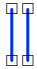

# Disjoint
<!-- id: disjoint-3 -->

Espacio de nombres: [Digi21.DigiNG.Entities.Relations](/digi3d-ai/programacion/.net/referencia/digi21.diging/digi21.diging.entities.relations/)  
Ensamblado: [Digi21.DigiNG](/digi3d-ai/programacion/.net/referencia/digi21.diging/)

Indica si las dos líneas son disjuntas.



```csharp
public static bool Disjoint(ReadOnlyLine a, ReadOnlyLine b)
```

| Parámetro | Descripción |
| :--- | :--- |
| `a` | Primera línea, de tipo [ReadOnlyLine](/digi3d-ai/programacion/.net/referencia/digi21.diging/digi21.diging.entities/clases/readonlyline/). |
| `b` | Segunda línea. |

## Valor devuelto

`true` si las cajas envolventes en planta de las dos líneas no se tocan o si ningún vértice de `a` coincide con un vértice de `b`. Los extremos cuentan como vértices.

Como solo se comparan vértices, dos líneas cuyos lados se cruzan sin un vértice común son disjuntas.

## Excepciones

| Excepción | Cuándo |
| :--- | :--- |
| `ArgumentNullException` | `a` o `b` es `null`. |

## Ejemplo

Lee el [ejemplo de LineLine](/digi3d-ai/programacion/.net/referencia/digi21.diging/digi21.diging.entities.relations/clases/lineline/#ejemplo).
