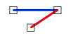

# EndpointJoinEndpoint
<!-- id: endpointjoinendpoint -->

Espacio de nombres: [Digi21.DigiNG.Entities.Relations](/digi3d-ai/programacion/.net/referencia/digi21.diging/digi21.diging.entities.relations/)  
Ensamblado: [Digi21.DigiNG](/digi3d-ai/programacion/.net/referencia/digi21.diging/)

Indica si las dos líneas se unen por uno de sus extremos.



```csharp
public static bool EndpointJoinEndpoint(ReadOnlyLine a, ReadOnlyLine b)
```

| Parámetro | Descripción |
| :--- | :--- |
| `a` | Primera línea, de tipo [ReadOnlyLine](/digi3d-ai/programacion/.net/referencia/digi21.diging/digi21.diging.entities/clases/readonlyline/). |
| `b` | Segunda línea. |

## Valor devuelto

`true` si se cumplen las dos condiciones:

* El primer o el último vértice de `a` coincide con el primer o el último vértice de `b`.
* Las dos líneas no son iguales según [Equal](/digi3d-ai/programacion/.net/referencia/digi21.diging/digi21.diging.entities.relations/clases/lineline/metodos-estaticos/equal.md).

El resto de los vértices no se analiza: las líneas pueden compartir además lados o vértices intermedios.

## Excepciones

| Excepción | Cuándo |
| :--- | :--- |
| `ArgumentNullException` | `a` o `b` es `null`. |

## Ejemplo

Lee el [ejemplo de LineLine](/digi3d-ai/programacion/.net/referencia/digi21.diging/digi21.diging.entities.relations/clases/lineline/#ejemplo).
