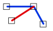

# EndpointJoinExcludingEndpoints
<!-- id: endpointjoinexcludingendpoints -->

Espacio de nombres: [Digi21.DigiNG.Entities.Relations](/digi3d-ai/programacion/.net/referencia/digi21.diging/digi21.diging.entities.relations/)  
Ensamblado: [Digi21.DigiNG](/digi3d-ai/programacion/.net/referencia/digi21.diging/)

Indica si un extremo de la primera línea se une con la segunda línea en un vértice que no es extremo de la segunda.



```csharp
public static bool EndpointJoinExcludingEndpoints(ReadOnlyLine a, ReadOnlyLine b)
```

| Parámetro | Descripción |
| :--- | :--- |
| `a` | Línea cuyos extremos se analizan, de tipo [ReadOnlyLine](/digi3d-ai/programacion/.net/referencia/digi21.diging/digi21.diging.entities/clases/readonlyline/). |
| `b` | Línea cuyos vértices intermedios se analizan. |

## Valor devuelto

`true` si el primer o el último vértice de `a` coincide con un vértice de `b` que no es ni el primero ni el último de `b`. Un extremo de `a` situado sobre un lado de `b`, sin coincidir con un vértice, no cuenta.

El método no es simétrico: para analizar los extremos de `b`, llama a `EndpointJoinExcludingEndpoints(b, a)`.

## Excepciones

| Excepción | Cuándo |
| :--- | :--- |
| `ArgumentNullException` | `a` o `b` es `null`. |

## Ejemplo

Lee el [ejemplo de LineLine](/digi3d-ai/programacion/.net/referencia/digi21.diging/digi21.diging.entities.relations/clases/lineline/#ejemplo).
