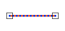

# Equal
<!-- id: equal-2 -->

Espacio de nombres: [Digi21.DigiNG.Entities.Relations](/digi3d-ai/programacion/.net/referencia/digi21.diging/digi21.diging.entities.relations/)  
Ensamblado: [Digi21.DigiNG](/digi3d-ai/programacion/.net/referencia/digi21.diging/)

Indica si las dos líneas son iguales.



```csharp
public static bool Equal(ReadOnlyLine a, ReadOnlyLine b)
```

| Parámetro | Descripción |
| :--- | :--- |
| `a` | Primera línea, de tipo [ReadOnlyLine](/digi3d-ai/programacion/.net/referencia/digi21.diging/digi21.diging.entities/clases/readonlyline/). |
| `b` | Segunda línea. |

## Valor devuelto

`true` si las dos líneas tienen el mismo número de vértices y cada vértice de `a` coincide con el vértice de `b` en la misma posición, recorriendo `b` en el mismo sentido o en sentido inverso.

El método no admite otro vértice inicial: dos líneas cerradas con el mismo contorno que empiezan en vértices distintos no son iguales. Para comparar contornos cerrados con cualquier vértice inicial, usa [AreaArea.Equal](/digi3d-ai/programacion/.net/referencia/digi21.diging/digi21.diging.entities.relations/clases/areaarea/metodos-estaticos/equal.md). La coordenada Z, los códigos y los atributos no se comparan.

## Excepciones

| Excepción | Cuándo |
| :--- | :--- |
| `ArgumentNullException` | `a` o `b` es `null`. |

## Ejemplo

Lee el [ejemplo de LineLine](/digi3d-ai/programacion/.net/referencia/digi21.diging/digi21.diging.entities.relations/clases/lineline/#ejemplo).
