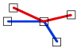

# Join
<!-- id: join-3 -->

Espacio de nombres: [Digi21.DigiNG.Entities.Relations](/digi3d-ai/programacion/.net/referencia/digi21.diging/digi21.diging.entities.relations/)  
Ensamblado: [Digi21.DigiNG](/digi3d-ai/programacion/.net/referencia/digi21.diging/)

Indica si las dos líneas se tocan en un vértice intermedio común, sin compartir lados ni cruzarse.



```csharp
public static bool Join(ReadOnlyLine a, ReadOnlyLine b)
```

| Parámetro | Descripción |
| :--- | :--- |
| `a` | Primera línea, de tipo [ReadOnlyLine](/digi3d-ai/programacion/.net/referencia/digi21.diging/digi21.diging.entities/clases/readonlyline/). |
| `b` | Segunda línea. |

## Valor devuelto

`true` si se cumplen las tres condiciones:

* Un vértice intermedio de `a` coincide con un vértice intermedio de `b`.
* Las líneas no comparten ningún lado: no hay dos vértices consecutivos de `a` que coincidan con dos vértices consecutivos de `b`.
* Las líneas no se cruzan en el primer vértice intermedio de `a` que coincide con un vértice intermedio de `b`, con el criterio de [Across](/digi3d-ai/programacion/.net/referencia/digi21.diging/digi21.diging.entities.relations/clases/lineline/metodos-estaticos/across.md). Los demás vértices comunes no se analizan.

Si las líneas solo coinciden en sus extremos, el método devuelve `false`; para ese caso usa [EndpointJoinEndpoint](/digi3d-ai/programacion/.net/referencia/digi21.diging/digi21.diging.entities.relations/clases/lineline/metodos-estaticos/endpointjoinendpoint.md) o [EndpointJoinExcludingEndpoints](/digi3d-ai/programacion/.net/referencia/digi21.diging/digi21.diging.entities.relations/clases/lineline/metodos-estaticos/endpointjoinexcludingendpoints.md).

## Excepciones

| Excepción | Cuándo |
| :--- | :--- |
| `ArgumentNullException` | `a` o `b` es `null`. |
