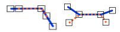

# Overlap
<!-- id: overlap-2 -->

Espacio de nombres: [Digi21.DigiNG.Entities.Relations](/digi3d-ai/programacion/.net/referencia/digi21.diging/digi21.diging.entities.relations/)  
Ensamblado: [Digi21.DigiNG](/digi3d-ai/programacion/.net/referencia/digi21.diging/)

Indica si las dos líneas se solapan: comparten al menos un lado.



```csharp
public static bool Overlap(ReadOnlyLine a, ReadOnlyLine b)
```

| Parámetro | Descripción |
| :--- | :--- |
| `a` | Primera línea, de tipo [ReadOnlyLine](/digi3d-ai/programacion/.net/referencia/digi21.diging/digi21.diging.entities/clases/readonlyline/). |
| `b` | Segunda línea. |

## Valor devuelto

`true` si se cumplen las dos condiciones:

* Dos vértices consecutivos de `a` coinciden con dos vértices consecutivos de `b`, en cualquier sentido.
* Las dos líneas no son iguales según [Equal](/digi3d-ai/programacion/.net/referencia/digi21.diging/digi21.diging.entities.relations/clases/lineline/metodos-estaticos/equal.md).

Para cada vértice de `a` solo se busca el primer vértice de `b` con el que coincide. Un tramo común que no empieza y termina en vértices de las dos líneas no se detecta.

## Excepciones

| Excepción | Cuándo |
| :--- | :--- |
| `ArgumentNullException` | `a` o `b` es `null`. |
